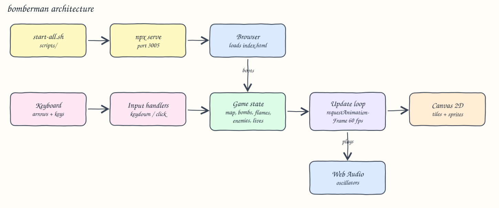
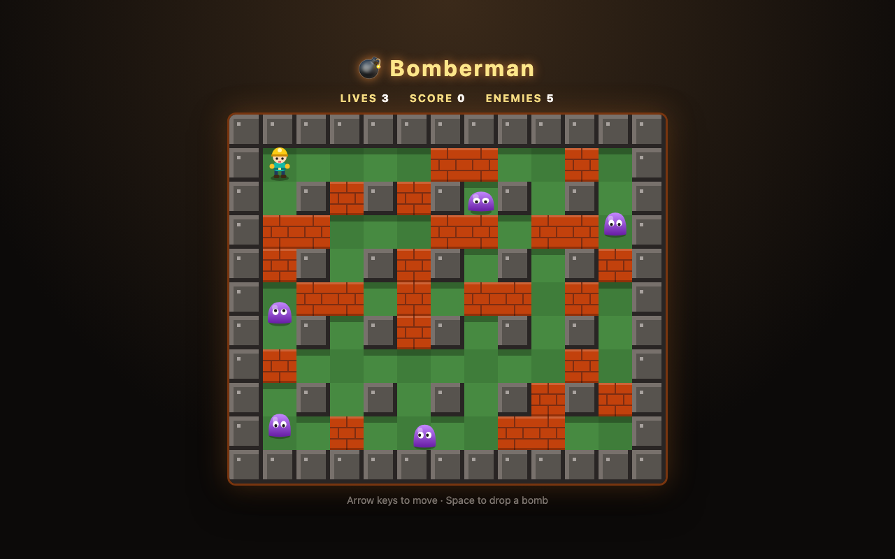
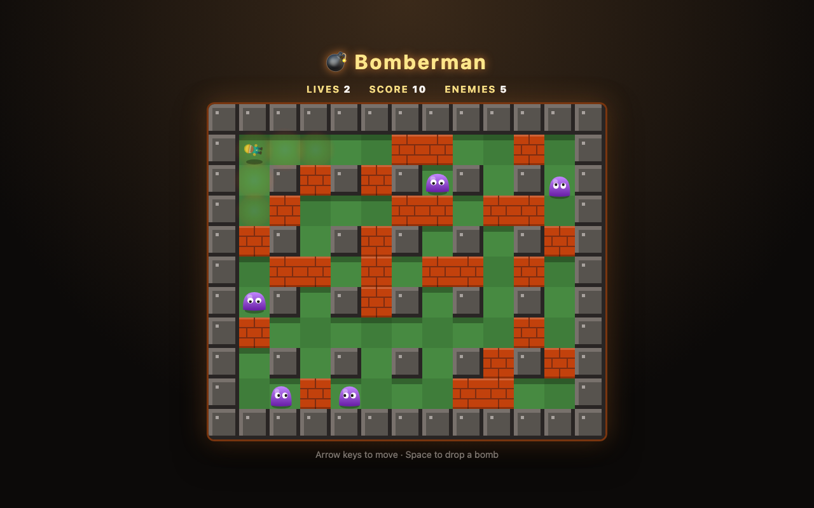

<p align="center"></p>

# Bomberman

A small bomb maze game. Drop bombs, break bricks and blast every slime on the stage before they catch you. All art and sounds are made in code.

## How it Works

* `index.html` holds the whole game.
* The map is a 13 by 11 grid of 48 pixel tiles: fixed walls, random bricks and open floor.
* `requestAnimationFrame` moves the hero and the slimes smoothly from tile to tile.
* A bomb burns for 1.6 seconds, then sends flames 2 tiles in each direction.
* Flames break bricks, hit slimes and set off other bombs in a chain.
* Touching a flame or a slime costs a life, 3 lives in total.
* Clearing all 5 slimes wins the stage, Enter plays again after the game ends.

## Architecture



## Features

* Chain bombs: one blast can set off the others for big combos.
* Slime enemies that wander the maze: the stage is always moving.
* Lives and score: the hero can take a few hits before the end.
* Animated hero and generated sounds: no image or audio files needed for gameplay.

## Stack

* HTML, CSS and plain JavaScript: no build step, no framework, the whole game is one page.
* Canvas 2D: tiles, the hero and slimes are drawn with shapes.
* Web Audio API: steps, fuses and explosions are synthesized.
* `serve` through `npx`: a static file server for local play, the game itself has no runtime dependencies.
* Bash scripts in `scripts/`: one predictable way to set up, start, check and stop the game.

## Contracts / APIs

There is no backend API. The only contract is the static file server: `GET /` returns `index.html` and every asset is a plain file next to it.

## Key data structures and design decisions

* `map` is a 2D grid of tile types, `passable(x, y)` answers every movement check.
* Movers made by `mover(x, y, speed)` keep a tile target and a pixel position, so motion is smooth but logic stays on the grid.
* `bombs` and `flames` are lists with timers, the loop counts them down with the frame delta.
* `RANGE`, `FUSE`, `MAX_BOMBS` and `ENEMY_COUNT` tune the game in one place.

## Controls

* Arrow keys move, hold them to keep walking.
* Space drops a bomb, at most 2 at a time.
* Enter plays again after the game ends.

## How to run

All scripts live in `scripts/` and run from any directory of the repository.

| Script | What it does |
|---|---|
| `./scripts/setup.sh` | Checks node and npx and fetches the `serve` static server once |
| `./scripts/start-all.sh` | Starts the game server and prints its full link |
| `./scripts/status.sh` | Shows the game server port as UP or DOWN |
| `./scripts/test-all.sh` | Checks the syntax of every script in the game, there are no test suites |
| `./scripts/ui.sh` | Opens the game in the browser |
| `./scripts/stop-all.sh` | Stops the game server |

Ports are declared in `scripts/ports.env`. This game runs on `http://localhost:3005`. You can also open `index.html` straight in a browser.

```bash
./scripts/setup.sh
./scripts/start-all.sh
./scripts/status.sh
./scripts/test-all.sh
./scripts/ui.sh
./scripts/stop-all.sh
```

## Printscreens

### Start



A new stage: the hero at the top left, bricks and five purple slimes in the maze, lives, score and enemies at the top.

### Bombing



The hero dropped bombs and took a hit, the flames cleared tiles near the start corner.
