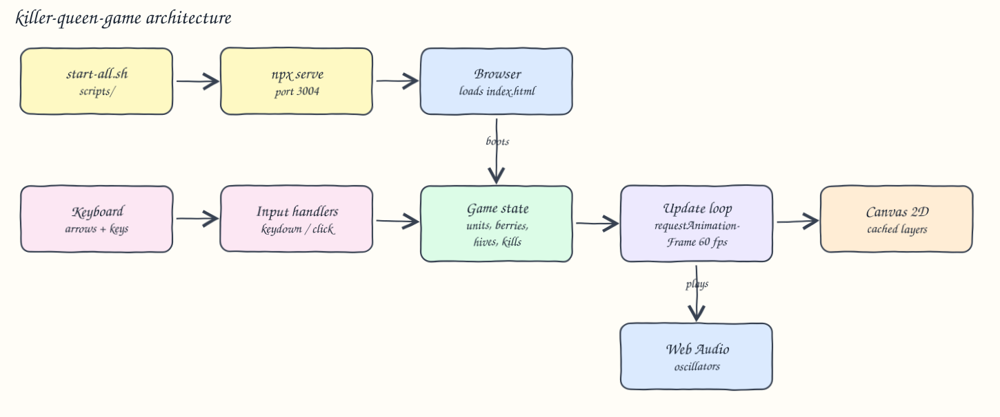
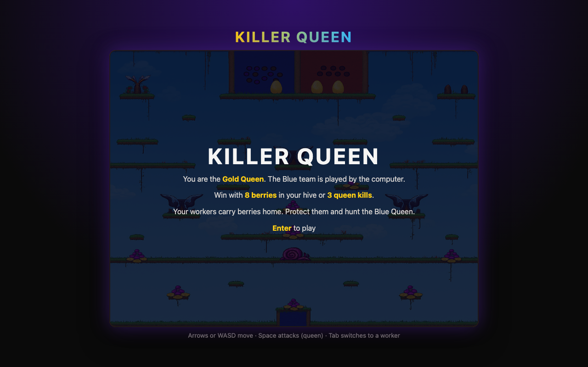
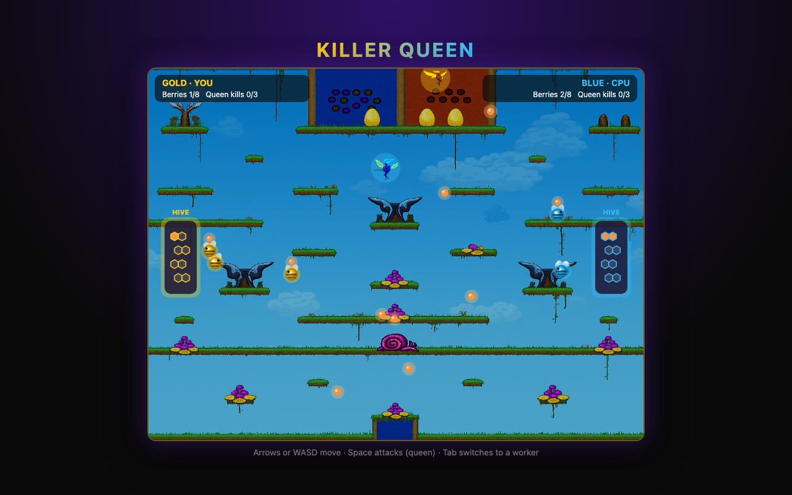

<p align="center"></p>

# Killer Queen

A small arcade battle. You play the Gold Queen against a Blue team run by the computer. Each team has a queen and 3 workers, win with berries or with queen kills.

## How it Works

* `index.html` holds the whole game, images are the PNG files next to it.
* `requestAnimationFrame` runs a 60 fps loop with held key movement.
* The background and both queens are pre rendered once into off screen canvases, then copied every frame.
* Workers fly to berries and carry them home, the CPU team and your idle workers decide on their own.
* Space makes your queen dash and stab, a hit knocks the enemy out for a few seconds and drops its berry.
* 8 berries in the hive or 3 queen kills wins, Enter starts and restarts.
* Sounds are generated with the Web Audio API.

## Architecture



## Features

* CPU Blue team: there is always an opponent without a second player.
* Queen attack with splash and screen shake: kills feel strong.
* Tab to take control of a worker: play the economy or the fight.
* Two win conditions: berries or kills, two ways to play.
* Start and end screens: clear match flow.

## Stack

* HTML, CSS and plain JavaScript: no build step, no framework, the whole game is one page.
* Canvas 2D with cached image layers: big PNG art drawn fast every frame.
* Web Audio API: hits, pickups and wins are synthesized.
* `serve` through `npx`: a static file server for local play, the game itself has no runtime dependencies.
* Bash scripts in `scripts/`: one predictable way to set up, start, check and stop the game.

## Contracts / APIs

There is no backend API. The only contract is the static file server: `GET /` returns `index.html` and every asset is a plain file next to it.

## Key data structures and design decisions

* `units` are plain objects made by `makeUnit(team, role, x, y)`, queens and workers share one shape.
* `HIVES` and `TEAM_COLORS` are keyed by team, so every rule works for both sides.
* `BERRIES_TO_WIN = 8`, `KILLS_TO_WIN = 3` and `MAX_BERRIES = 14` tune the match in one place.
* `keys` is a map of held keys, so movement is smooth and not tied to key repeat.

## Controls

* Arrows or WASD move.
* Space attacks with the queen.
* Tab switches control to one of your workers.
* Enter starts and restarts the match.

## How to run

All scripts live in `scripts/` and run from any directory of the repository.

| Script | What it does |
|---|---|
| `./scripts/setup.sh` | Checks node and npx and fetches the `serve` static server once |
| `./scripts/start-all.sh` | Starts the game server and prints its full link |
| `./scripts/status.sh` | Shows the game server port as UP or DOWN |
| `./scripts/test-all.sh` | Checks the syntax of every script in the game, there are no test suites |
| `./scripts/ui.sh` | Opens the game in the browser |
| `./scripts/stop-all.sh` | Stops the game server |

Ports are declared in `scripts/ports.env`. This game runs on `http://localhost:3004`. You can also open `index.html` straight in a browser.

```bash
./scripts/setup.sh
./scripts/start-all.sh
./scripts/status.sh
./scripts/test-all.sh
./scripts/ui.sh
./scripts/stop-all.sh
```

## Printscreens

### Start screen



The rules of the match over the dimmed arena: you are the Gold Queen, win with 8 berries or 3 queen kills, Enter to play.

### Match



The match in play: gold and blue workers carry berries, each team hive fills on its side and the score panels show berries and queen kills.
