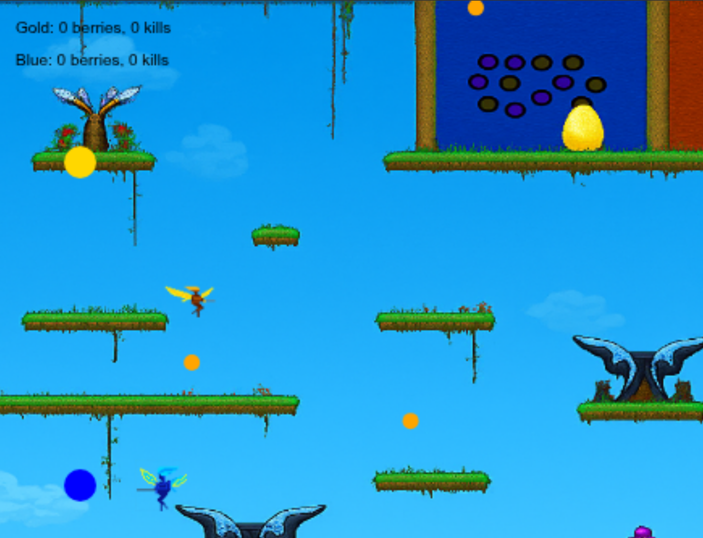

### Killer Queen

You play the Gold Queen against a Blue team controlled by the computer. Each team has a queen and 3 workers.

* Arrows or WASD move.
* Space attacks with the queen: a fast dash and stab that knocks out any enemy it hits.
* Tab switches control to one of your workers, the rest of your team plays on its own.
* Workers carry berries to their hive. Knocked out characters drop their berry and come back after a few seconds.
* Win with 8 berries in your hive or 3 queen kills.
* Enter starts and restarts the match.

Sounds are generated with the Web Audio API.

### Run

```bash
npm start
```

goto: http://localhost:3000/ or open `index.html` in a web browser.

### Result


