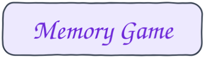
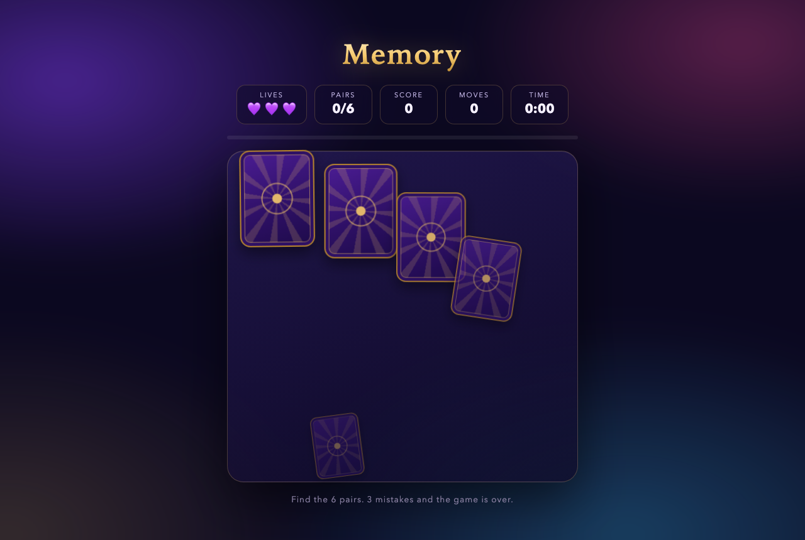
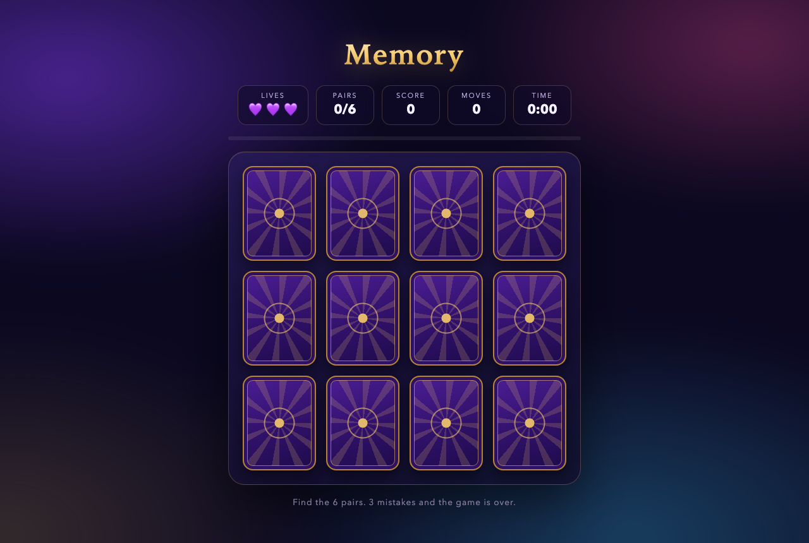
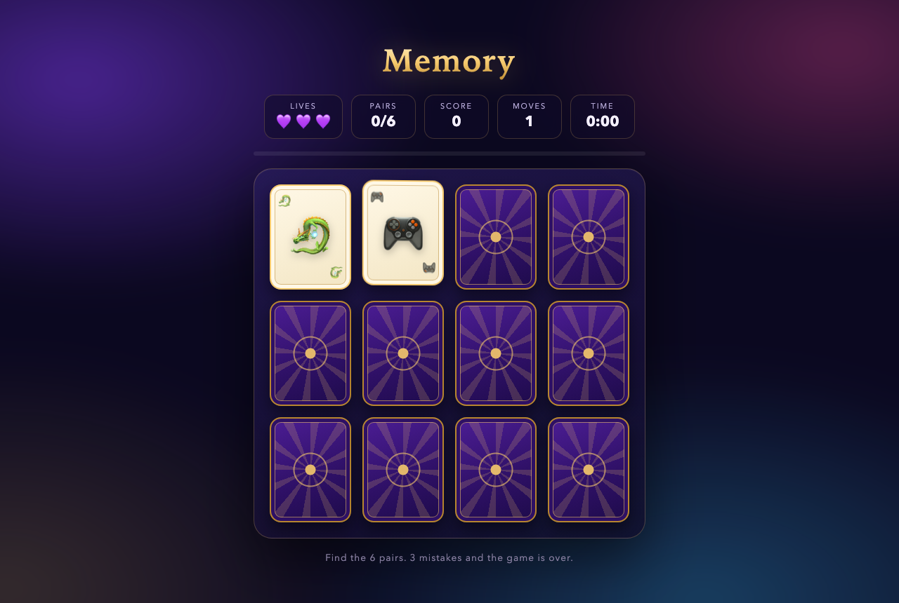
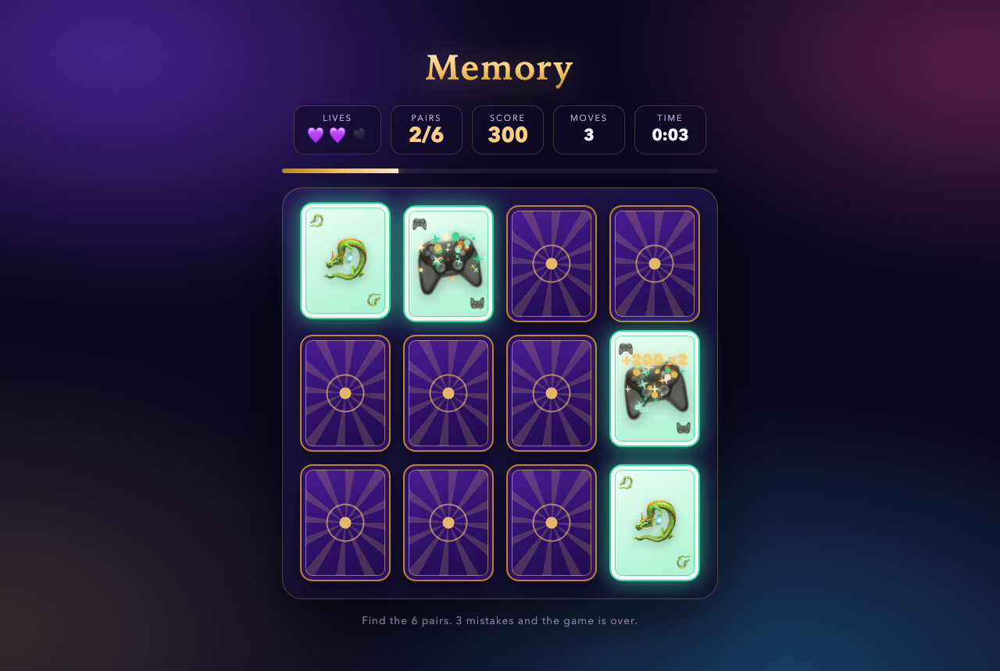
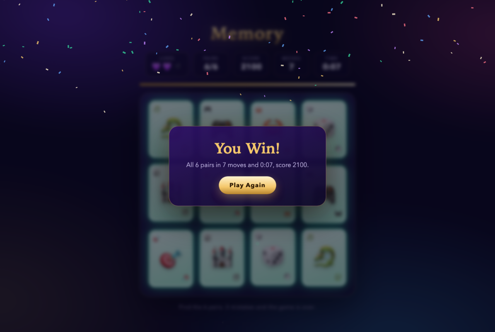
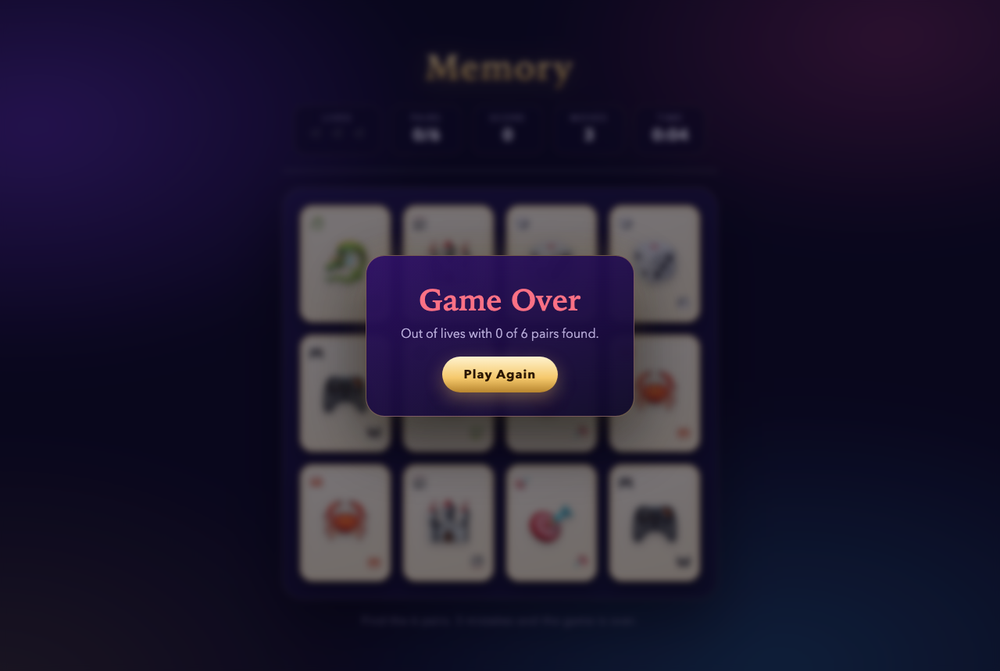

<p align="center"></p>

# Memory Game

A tarot style memory game. Flip two cards at a time and find the six pairs before you lose your three lives. Gold foil cards, 3D flips, sparkles, confetti and generated sounds, all in one HTML file with no libraries.

## How it Works

* `index.html` holds the markup, the styles and the script.
* Six symbols are doubled and shuffled with Fisher Yates into twelve cards, then dealt onto the table with a staggered fly in.
* Clicking a card adds it to the open pair at once and turns it with a real CSS 3D flip, front and back are two faces of one card.
* When two cards are open the game waits 0.7 seconds and compares them.
* A match turns both cards mint, bursts sparkles on a canvas layer and scores 100 times the current combo.
* A miss turns both cards red, shakes the board, breaks one life and resets the combo.
* Six pairs wins with confetti, three misses reveals every card and ends the game. Play Again deals a new board without reloading.
* Sounds are generated with the Web Audio API, they start on the first click.

## Architecture


## Features

* Gold foil tarot cards: a sunburst back drawn only with CSS gradients, a cream front with corner pips.
* Real 3D flip with a springy ease: the card turns over instead of squashing.
* Deal animation: cards fly in from below one by one when a game starts.
* Hover tilt and shine: cards lean toward the cursor and a light streak crosses the back.
* Combo scoring: each match in a row is worth more, a miss resets it, a floating score shows the gain.
* Sparkle bursts and confetti: a canvas particle layer above the table for matches and the win.
* Lives, pairs, score, moves and time in the HUD, with a gold progress bar.
* Win and game over panels with stats and Play Again.
* Click guard: the same card can not be clicked twice and only two cards can be open at once.
* Reduced motion: animations are turned off when the system asks for it.

## Stack

* HTML, CSS and plain JavaScript: no build step, no framework, the whole game is one page.
* CSS 3D transforms and keyframes: flips, deal, tilt, shake and float with no animation library.
* Canvas 2D: one full screen layer for sparkles and confetti.
* Web Audio API: flip, match, miss, win and lose sounds are synthesized.
* `serve` through `npx`: a static file server for local play, the game itself has no runtime dependencies.
* Bash scripts in `scripts/`: one predictable way to set up, start, check and stop the game.

## Contracts / APIs

There is no backend API. The only contract is the static file server: `GET /` returns `index.html` and every asset is a plain file next to it.

## Key data structures and design decisions

* `cards` is the shuffled symbol array, each card element keeps its symbol in `data-symbol`.
* `flipped` holds the open pair, a card joins it on click, before the animation, so fast clicks can not cheat.
* `combo`, `score`, `matchedCount`, `mistakes` and `moves` drive the HUD and decide the win and the loss.
* `particles` is one list for sparkles and confetti, filtered every frame, so the effect layer never grows.
* Cards are DOM elements and effects are canvas: the DOM gives crisp 3D cards, the canvas gives cheap particles.

## Controls

* Click a card to flip it.
* Play Again starts a new deal.

## How to run

All scripts live in `scripts/` and run from any directory of the repository.

| Script | What it does |
|---|---|
| `./scripts/setup.sh` | Checks node and npx and fetches the `serve` static server once |
| `./scripts/start-all.sh` | Starts the game server and prints its full link |
| `./scripts/status.sh` | Shows the game server port as UP or DOWN |
| `./scripts/test-all.sh` | Checks the syntax of every script in the game, there are no test suites |
| `./scripts/ui.sh` | Opens the game in the browser |
| `./scripts/stop-all.sh` | Stops the game server |

Ports are declared in `scripts/ports.env`. This game runs on `http://localhost:3003`.

```bash
./scripts/setup.sh
./scripts/start-all.sh
./scripts/status.sh
./scripts/test-all.sh
./scripts/ui.sh
./scripts/stop-all.sh
```

## Printscreens

### Dealing



A new game deals the cards: they fly in from below with a spin, one after the other.

### Ready



Twelve gold foil cards face down, three lives and an empty progress bar.

### Two cards open



A dragon and a gamepad turned over with the 3D flip, the move counter is at 1.

### Mistake


The pair does not match: both cards glow red, the board shakes and one life breaks.

### Match and combo



Two pairs in a row: matched cards turn mint and float, sparkles burst and the floating +200 x2 shows the combo bonus.

### Win



All six pairs found, confetti falls and the panel shows moves, time and the final score.

### Game over



Three mistakes: every card is revealed and the Game Over panel offers Play Again.
