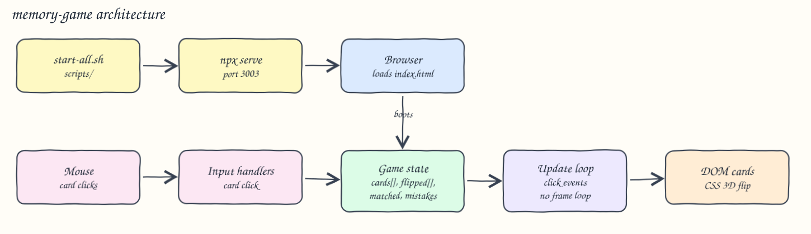
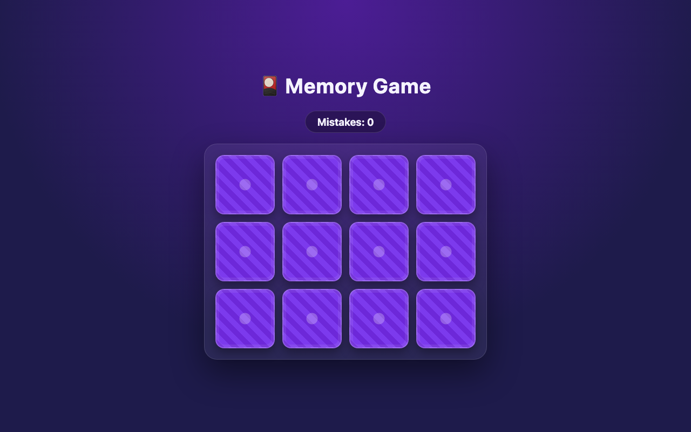
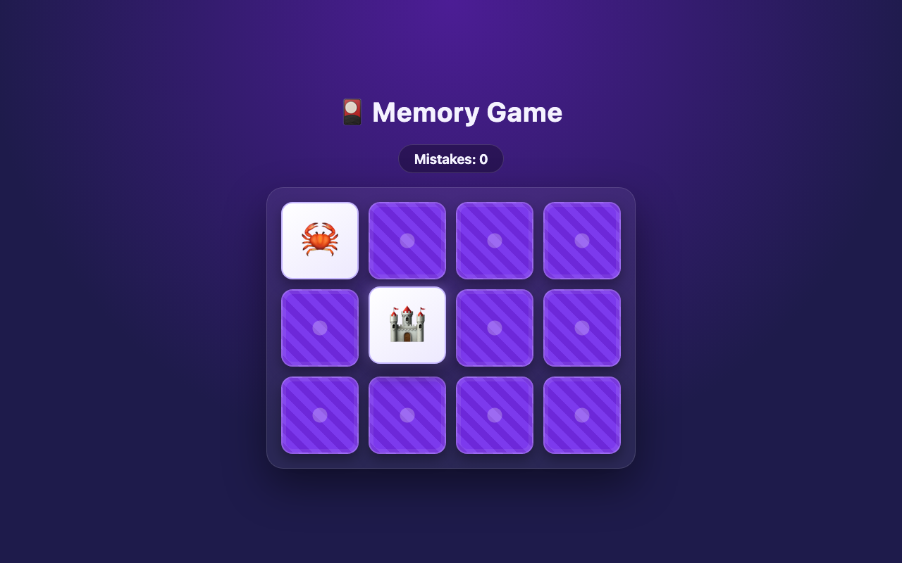

<p align="center"></p>

# Memory Game

Flip two cards at a time and find the six pairs. Three mistakes and the game is over.

## How it Works

* `index.html` holds the markup, the styles and the script.
* Six emoji symbols are doubled and shuffled into twelve cards.
* Clicking a card adds it to the open pair at once, then a short CSS flip shows its symbol.
* When two cards are open the game waits one second and compares them.
* A pair stays matched, a wrong pair flips back and counts a mistake.
* Six pairs wins, three mistakes ends the game and locks the board.

## Architecture



## Features

* Card flip animation: a non mirrored flip so the symbol always reads correctly.
* Mistake counter: a clear limit makes every guess matter.
* Win and game over states shown in the status pill.
* Click guard: the same card can not be clicked twice and only two cards can be open at once.

## Stack

* HTML, CSS and plain JavaScript: no build step, no framework, the whole game is one page.
* DOM and CSS transitions: cards are plain elements, no canvas needed.
* `serve` through `npx`: a static file server for local play, the game itself has no runtime dependencies.
* Bash scripts in `scripts/`: one predictable way to set up, start, check and stop the game.

## Contracts / APIs

There is no backend API. The only contract is the static file server: `GET /` returns `index.html` and every asset is a plain file next to it.

## Key data structures and design decisions

* `cards` is the shuffled symbol array, each card element keeps its symbol in `data-symbol`.
* `flipped` holds the open pair, a card joins it on click, before the animation, so fast clicks can not cheat.
* `matchedCount` and `mistakes` decide the win and the loss.

## Controls

* Click a card to flip it.
* Reload the page to play again.

## How to run

All scripts live in `scripts/` and run from any directory of the repository.

| Script | What it does |
|---|---|
| `./scripts/setup.sh` | Checks node and npx and fetches the `serve` static server once |
| `./scripts/start-all.sh` | Starts the game server and prints its full link |
| `./scripts/status.sh` | Shows the game server port as UP or DOWN |
| `./scripts/test-all.sh` | Checks the syntax of every script in the game, there are no test suites |
| `./scripts/ui.sh` | Opens the game in the browser |
| `./scripts/stop-all.sh` | Stops the game server |

Ports are declared in `scripts/ports.env`. This game runs on `http://localhost:3003`.

```bash
./scripts/setup.sh
./scripts/start-all.sh
./scripts/status.sh
./scripts/test-all.sh
./scripts/ui.sh
./scripts/stop-all.sh
```

## Printscreens

### Start



Twelve face down cards and zero mistakes.

### Two cards open



A crab and a castle are open, they do not match so they will flip back and count a mistake.
