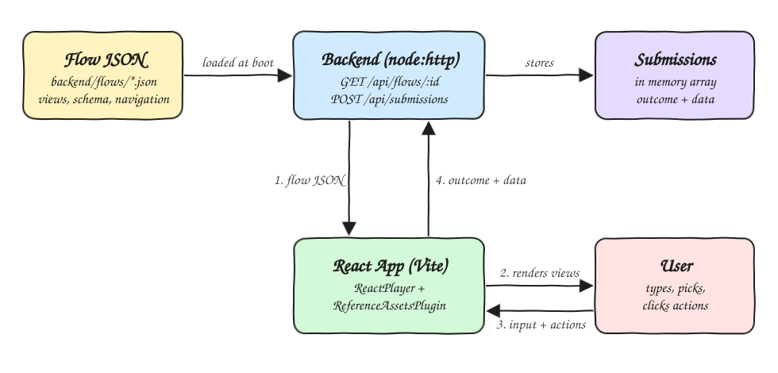
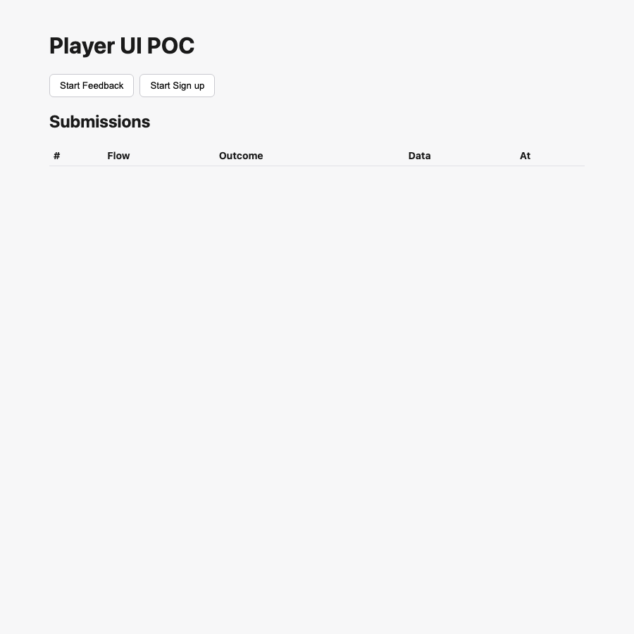
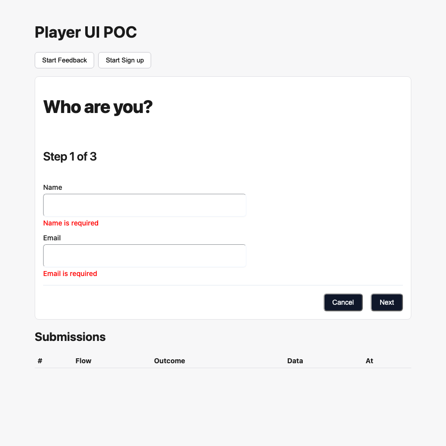
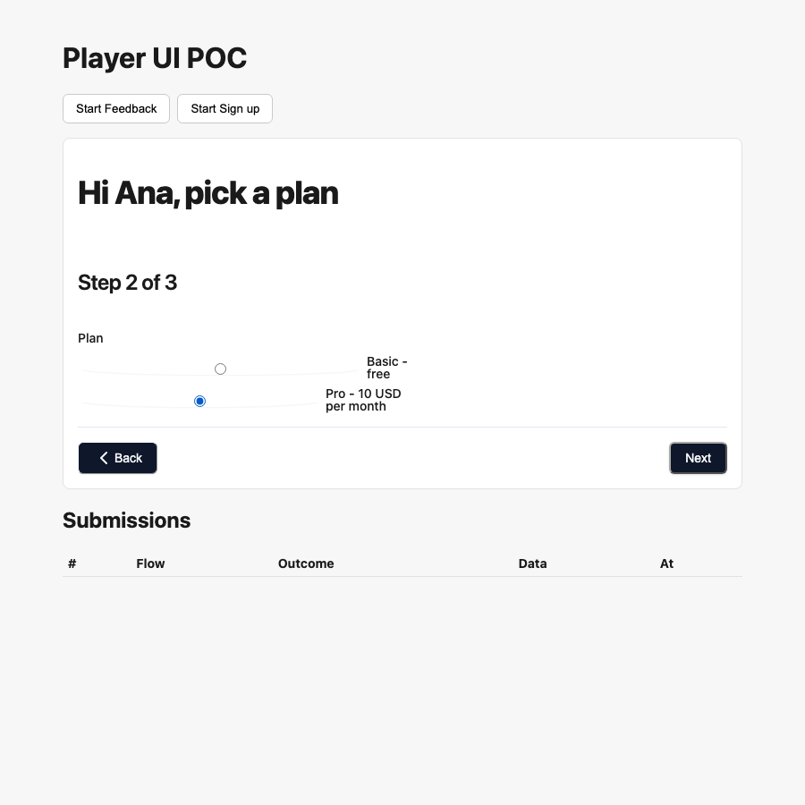
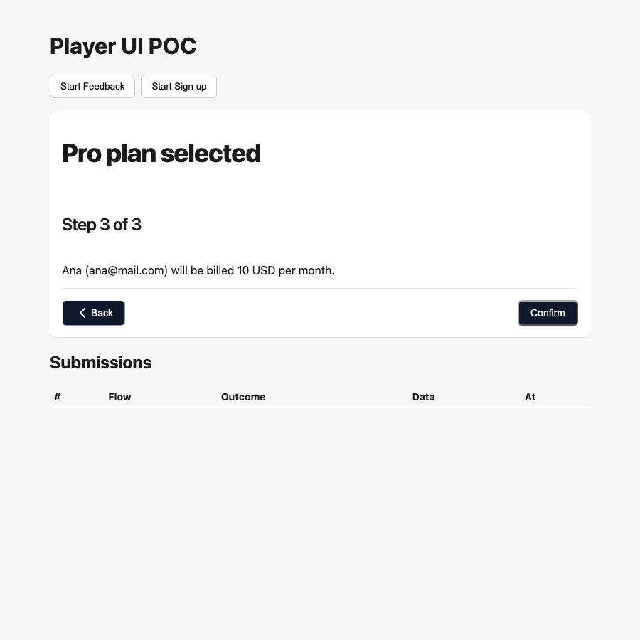
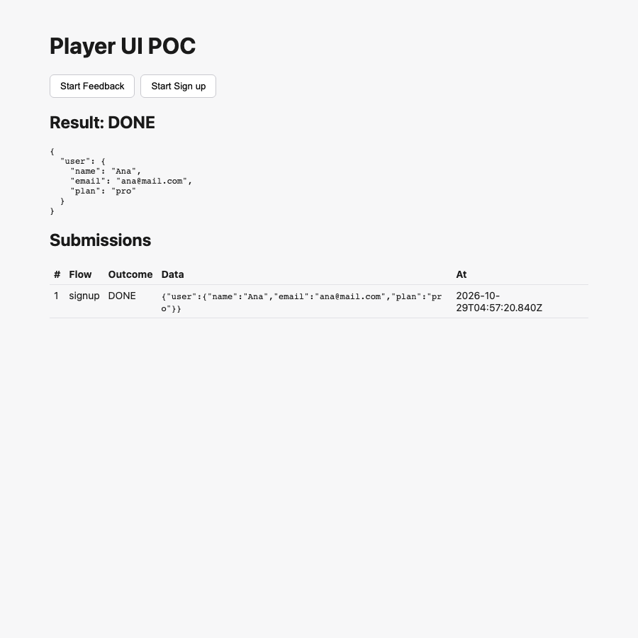
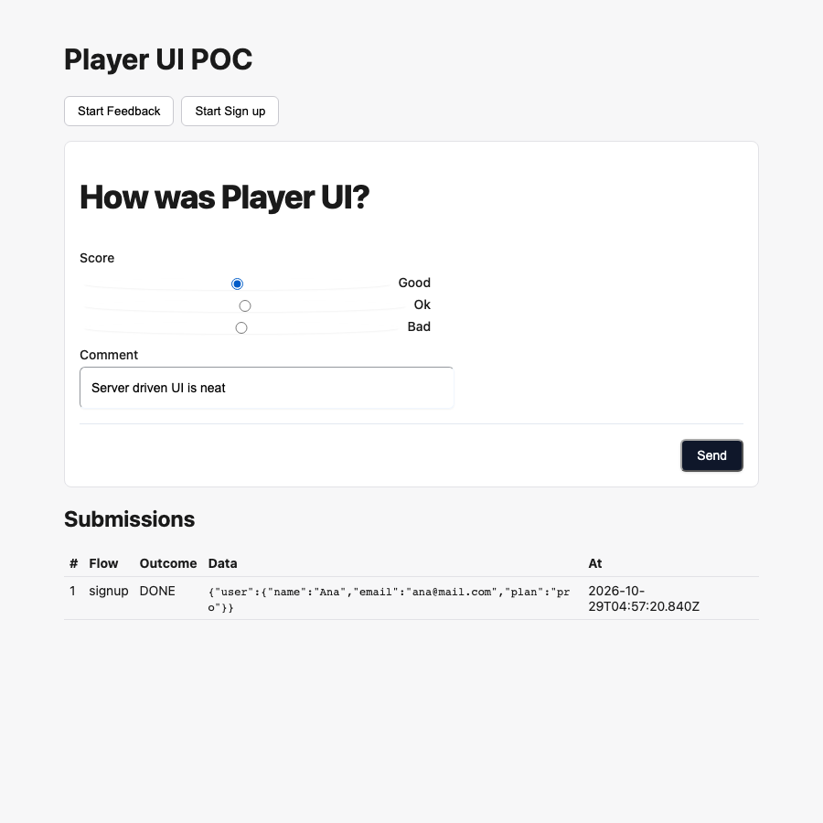
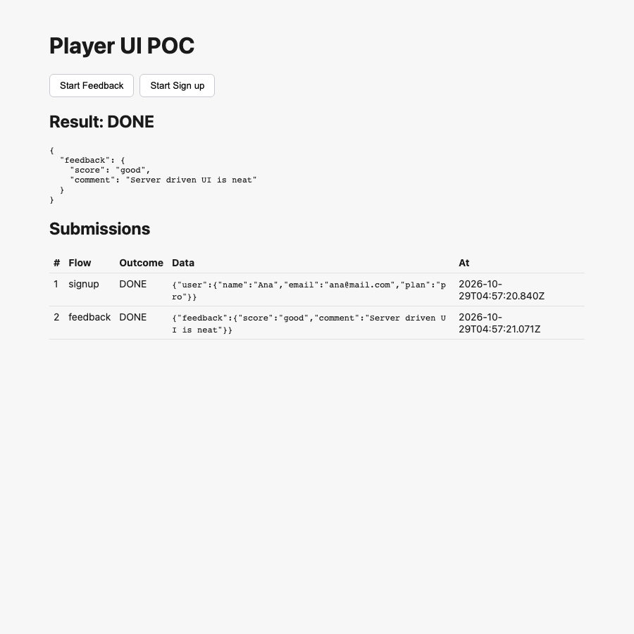

# Player UI POC

A server driven UI proof of concept with [Player UI](https://player-ui.github.io/next/). The backend serves Player flows as plain JSON (views, data, schema validation and a navigation state machine) and a React app renders them with `ReactPlayer`. When a flow ends, the app sends the outcome and the collected data back to the backend.

Changing a screen, a validation rule or the order of steps means editing a JSON file on the server. The frontend does not change.

## How it Works

1. The backend loads every file in `backend/flows/` at boot and serves it on `GET /api/flows/:id`.
2. The React app lists the flows and fetches one when you click `Start`.
3. `FlowPlayer` creates a `ReactPlayer` with the `ReferenceAssetsPlugin` and calls `start(flow)`.
4. Player walks the `navigation` state machine. Each `VIEW` state renders a view built from assets (`info`, `collection`, `input`, `choice`, `text`, `action`).
5. Inputs write to the data model through their `binding` (such as `user.email`). The `schema` validators run on those bindings and block a transition while data is invalid.
6. `ACTION` states evaluate expressions to branch (`{{user.plan}}` routes to the pro or basic view).
7. An `END` state resolves `start()` with `endState.outcome` and `data`, and the app stores them with `POST /api/submissions`.

## Architecture



## Features

* **Server driven flows**: screens live in `backend/flows/*.json`, so the UI changes without a frontend deploy.
* **Data binding**: `input` and `choice` assets read from and write to the Player data model through `binding`.
* **Schema validation**: `required` and `email` validators with custom messages are declared in the flow `schema`, and an invalid view cannot move forward.
* **Templated text**: `{{user.name}}` inside any text asset is resolved from the data model at render time.
* **Branching navigation**: an `ACTION` state evaluates `{{user.plan}}` and picks the next view.
* **Back and cancel**: the `Prev` action goes back with data kept, and `skipValidation` lets cancel exit a half filled form.
* **Flow outcomes**: `END` states return `DONE` or `CANCELLED` together with the collected data.
* **Submission history**: the backend keeps every finished flow in memory, and the UI lists them.

## Stack

* **@player-ui/react 1.3**: the Player runtime for React. It runs the state machine, data model, validation and expressions.
* **@player-ui/reference-assets-plugin-react 1.3**: ready made `info`, `input`, `choice`, `text`, `action` and `collection` components. It also brings the common types, common expressions and computed properties plugins.
* **React 18**: Player 1.3 declares React 18 as its peer dependency.
* **Vite 6**: dev server and build, with an `/api` proxy to the backend.
* **Node.js `node:http`**: the backend has zero dependencies.
* **node:test**: backend tests with no extra library.
* **Vitest + Testing Library + jsdom**: run the real Player against the real flow JSON.

## Contracts / APIs

| Method | Path | Body | Response |
|---|---|---|---|
| GET | `/api/flows` | | `200 [{ "id", "title" }]` |
| GET | `/api/flows/:id` | | `200` full Player flow JSON, `404` when unknown |
| POST | `/api/submissions` | `{ "flowId", "outcome", "data" }` | `201` stored submission, `400` when `flowId` is unknown, `outcome` is missing, `data` is not an object, or the JSON is invalid |
| GET | `/api/submissions` | | `200 [{ "id", "flowId", "outcome", "data", "at" }]` |

## Key Data Structures and Design Decisions

A Player flow is one JSON document:

```json
{
  "id": "signup",
  "data": { "user": { "name": "", "email": "", "plan": "basic" } },
  "schema": {
    "ROOT": { "user": { "type": "UserType" } },
    "UserType": {
      "email": { "type": "StringType", "validation": [{ "type": "required" }, { "type": "email" }] }
    }
  },
  "views": [{ "id": "profile-view", "type": "info", "...": "assets" }],
  "navigation": {
    "BEGIN": "FLOW_1",
    "FLOW_1": {
      "startState": "VIEW_PROFILE",
      "VIEW_PROFILE": { "state_type": "VIEW", "ref": "profile-view", "transitions": { "next": "VIEW_PLAN", "cancel": "END_CANCELLED" } },
      "ACTION_ROUTE_PLAN": { "state_type": "ACTION", "exp": "{{user.plan}}", "transitions": { "pro": "VIEW_PRO", "*": "VIEW_BASIC" } },
      "END_DONE": { "state_type": "END", "outcome": "DONE" }
    }
  }
}
```

* **The player must sit inside `<Suspense>`**: `ReactPlayer.Component` suspends until the first view exists. Without a boundary the parent never commits, the `useEffect` that calls `start()` never runs, and the screen stays blank. `frontend/src/FlowPlayer.jsx` wraps it for this reason.
* **One `ReactPlayer` per run**: a new instance is created for each flow start (`useMemo` on the flow plus a `key` per run). That way a restarted flow always begins clean.
* **Flows are content, so they are tested as content**: `backend/test/flows.test.js` checks that every `VIEW` ref exists, every transition lands on a real state, every binding is in the schema, and asset ids are unique. A broken flow fails the build before a user sees it.
* **In memory submissions**: the POC has no database, so history resets when the backend restarts.
* **Reference asset styling as is**: the reference components bring their own Tailwind based CSS. The radio layout on the plan step is how those reference components look. A real app would register its own design system assets.

## How to Run

Requires Node.js 20+.

```bash
./scripts/setup.sh
./scripts/start-all.sh
./scripts/ui.sh
```

Then open http://localhost:5180 (the backend is on http://localhost:3011/api).

Run every test:

```bash
./scripts/test-all.sh
```

* Backend: 16 tests for flow content integrity and the REST contract.
* Frontend: 5 tests that drive the real Player through the signup flow. They cover validation blocking, plan branching, the returned data, back keeping typed data, and cancel.

## Printscreens

### Home


The backend lists the available flows. Each button fetches that flow's JSON and starts Player.

### Sign up, validation


`Next` was clicked with empty fields. The `required` validators from the flow schema block the transition and show the messages defined in the JSON.

### Sign up, plan choice


The title `Hi {{user.name}}, pick a plan` is resolved from the data model. The `choice` asset is bound to `user.plan`. `Back` is a `Prev` action, so Player renders it on the left.

### Sign up, pro review


The `ACTION_ROUTE_PLAN` state evaluated `{{user.plan}}` as `pro` and routed to the pro view, which templates name and email.

### Sign up, result


`Confirm` reached the `END_DONE` state. `start()` resolved with outcome `DONE` and the data, and the app posted them to the backend.

### Feedback flow


A second flow from the same backend, mixing a `choice` and a free text `input` inside a `collection`.

### Submissions


Both finished flows, as the backend stored them.

## Scripts

All scripts live in `scripts/` and run from any directory of the repository.

| Script | What it does |
|---|---|
| `./scripts/setup.sh` | Installs dependencies and prepares the app |
| `./scripts/start-all.sh` | Starts every service and prints the full link of each one |
| `./scripts/status.sh` | Shows every service port as UP or DOWN |
| `./scripts/test-all.sh` | Runs every test suite |
| `./scripts/ui.sh` | Opens the UI in the browser |
| `./scripts/stop-all.sh` | Stops every service |

Ports are declared in `scripts/ports.env` (backend `3011`, frontend `5180`).

```bash
./scripts/setup.sh
./scripts/start-all.sh
./scripts/status.sh
./scripts/ui.sh
./scripts/stop-all.sh
```
