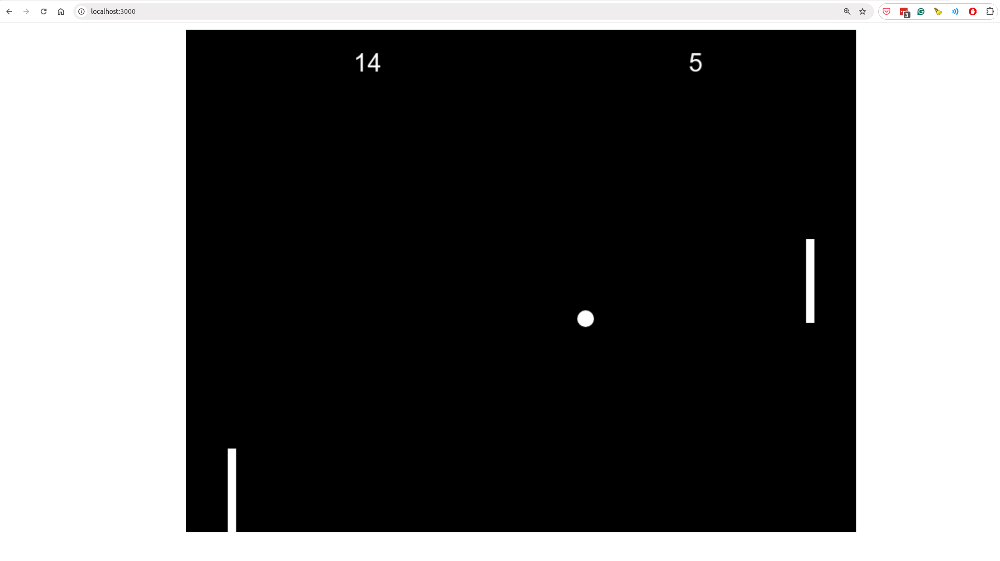

### Pong Game



Two player online Pong. The server runs the ball and the score, each browser tab is one player.

### How to play

* Open the game link in two browser tabs, the first tab is Player 1 (left, cyan), the second is Player 2 (right, pink).
* Arrow Up and Arrow Down move your paddle.

## Scripts

All scripts live in `scripts/` and run from any directory of the repository.

| Script | What it does |
|---|---|
| `./scripts/setup.sh` | Installs dependencies and prepares the app |
| `./scripts/start-all.sh` | Starts the game server and prints its full link |
| `./scripts/status.sh` | Shows the game server port as UP or DOWN |
| `./scripts/test-all.sh` | Checks the syntax of every source file, there are no test suites |
| `./scripts/ui.sh` | Opens the game in the browser |
| `./scripts/stop-all.sh` | Stops the game server |

Ports are declared in `scripts/ports.env`.

```bash
./scripts/setup.sh
./scripts/start-all.sh
./scripts/status.sh
./scripts/ui.sh
./scripts/stop-all.sh
```
