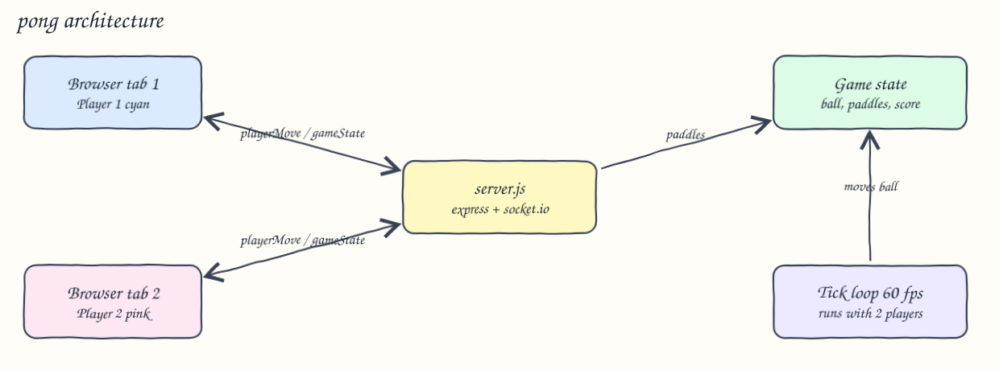
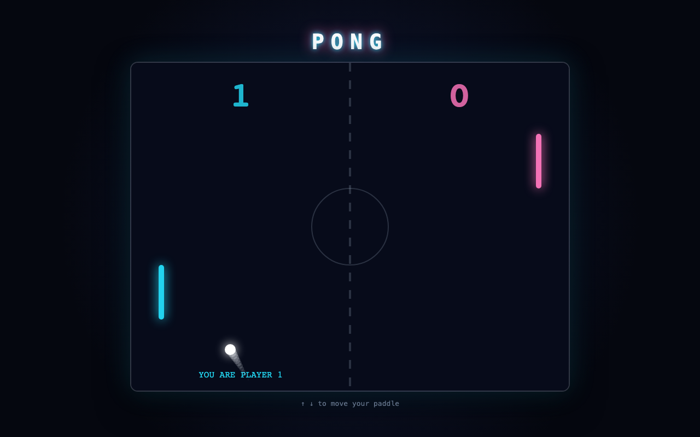
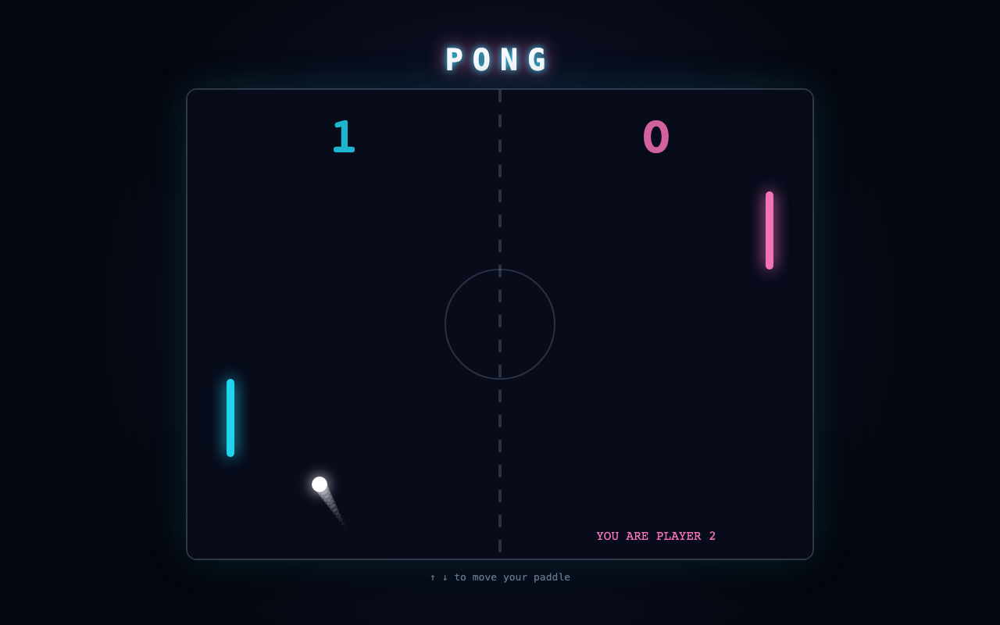
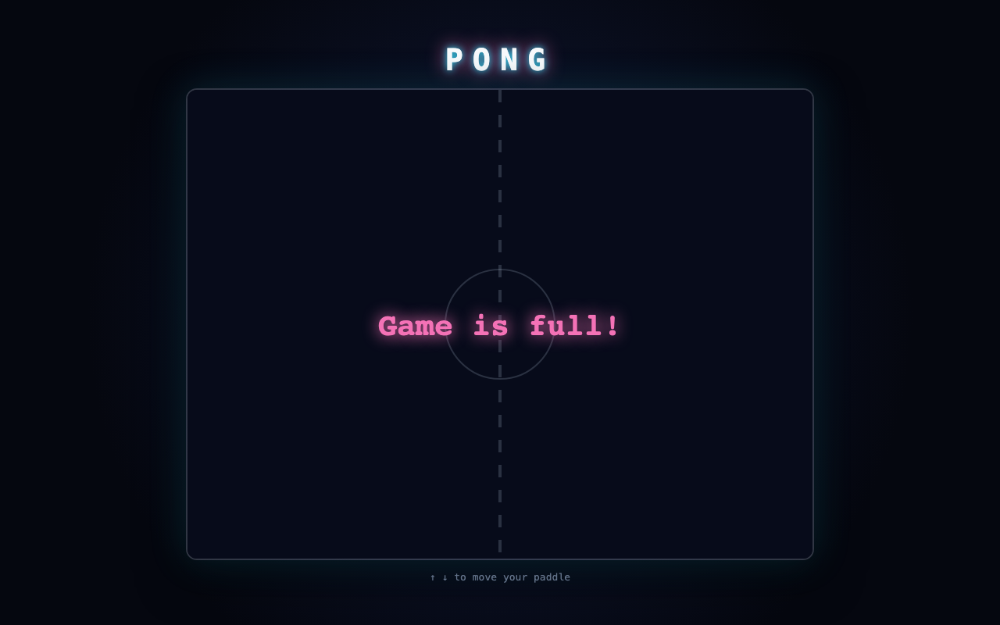

<p align="center"></p>

# Pong

Two player online Pong. The server runs the ball and the score, each browser tab is one player.

## How it Works

* `src/server.js` serves the page with Express and talks to the tabs with Socket.IO.
* The first tab to join is Player 1 (left, cyan), the next is Player 2 (right, pink). A third tab gets a game is full message.
* When a player leaves, the next tab takes the free slot, so there are never two Player 2.
* Arrow keys move your paddle in the tab, the tab sends `playerMove` to the server.
* The server ticks 60 times a second, but only while both players are connected.
* Each tick moves the ball, bounces it on walls and paddles and scores misses, then sends `gameState` to every tab.
* Scores reset when the second player joins, so a match always starts at 0 to 0.

## Architecture



## Features

* Server authoritative ball and score: both tabs always see the same game.
* Slot based player numbers: rejoining never duplicates a player.
* Waits for two players: no score piles up while nobody plays.
* Neon canvas look with a ball trail.

## Stack

* Node.js: runs the game server.
* Express: serves the static page and the client script.
* Socket.IO: real time messages between the tabs and the server.
* Canvas 2D on the client: draws the court, paddles and ball.
* Bash scripts in `scripts/`: one predictable way to set up, start, check and stop the game.

## Contracts / APIs

| Direction | Event | Payload | Meaning |
|---|---|---|---|
| server to tab | `playerNumber` | `1` or `2` | Which paddle this tab controls |
| server to tab | `full` | `true` | Two players are already in, the tab is disconnected |
| tab to server | `playerMove` | `{ paddleY }` | New paddle position, 0 to 500 |
| server to tab | `gameState` | `{ player1: {y, score}, player2: {y, score}, ball }` | The whole state, 60 times a second |

## Key data structures and design decisions

* `players` maps a socket id to `{ paddleY, score, number }`, `number` is the slot, taken from the free one.
* `gameState` is the single source of truth, the clients only draw it.
* The court is 800 by 600 and the paddles are 100 tall, the server owns all physics.

## How to run

All scripts live in `scripts/` and run from any directory of the repository.

| Script | What it does |
|---|---|
| `./scripts/setup.sh` | Installs dependencies and prepares the app |
| `./scripts/start-all.sh` | Starts the game server and prints its full link |
| `./scripts/status.sh` | Shows the game server port as UP or DOWN |
| `./scripts/test-all.sh` | Checks the syntax of every source file, there are no test suites |
| `./scripts/ui.sh` | Opens the game in the browser |
| `./scripts/stop-all.sh` | Stops the game server |

Ports are declared in `scripts/ports.env`. This game runs on `http://localhost:3000`. Open the link in two browser tabs, one per player.

```bash
./scripts/setup.sh
./scripts/start-all.sh
./scripts/status.sh
./scripts/test-all.sh
./scripts/ui.sh
./scripts/stop-all.sh
```

## Printscreens

### Player 1 tab



The left tab is Player 1 with the cyan paddle, the score and the ball come from the server.

### Player 2 tab



The second tab sees the same ball and score at the same moment, it controls the pink paddle.

### Game is full



A third tab is turned away with a game is full message.
