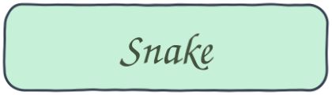
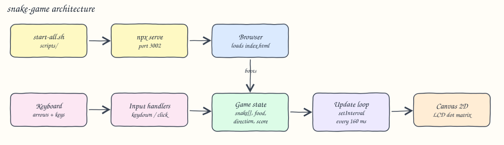
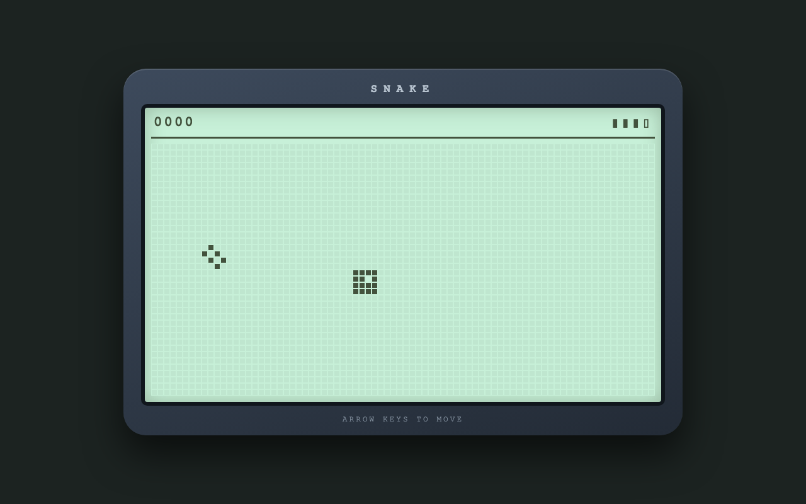
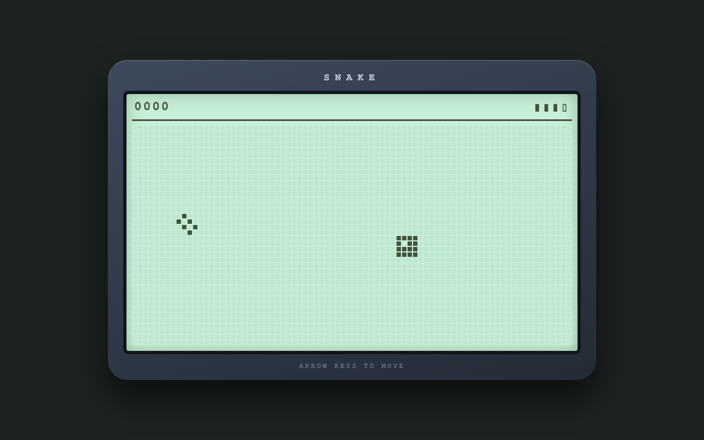
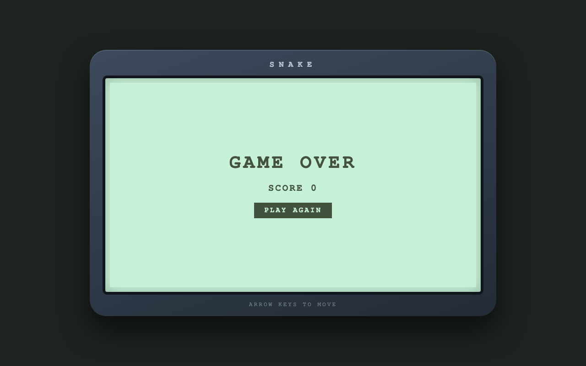

<p align="center"></p>

# Snake

Classic snake with the look of an old monochrome LCD phone. Eat the food, grow longer and do not hit the walls or yourself.

## How it Works

* `index.html` draws the phone frame, `game.js` runs the game on a canvas.
* `setInterval` ticks every 160 ms: move the head one cell, then check walls, body and food.
* Eating food grows the snake by keeping the tail, otherwise the tail is dropped.
* Every cell is drawn as a 4 by 4 block of LCD dots for the retro phone look.
* Food never spawns on the snake.
* A turn only counts against the direction the snake really moved, so two quick keys can not reverse it into itself.

## Architecture



## Features

* LCD dot matrix rendering: the faint ghost dots make it look like a real old screen.
* Safe start: the snake starts in the middle row so the first key never kills it.
* Score counter with four digits: the classic phone style.
* Game over screen with Play Again.

## Stack

* HTML, CSS and plain JavaScript: no build step, no framework, the whole game is one page.
* Canvas 2D: a grid of tiny squares is all the art.
* `serve` through `npx`: a static file server for local play, the game itself has no runtime dependencies.
* Bash scripts in `scripts/`: one predictable way to set up, start, check and stop the game.

## Contracts / APIs

There is no backend API. The only contract is the static file server: `GET /` returns `index.html` and every asset is a plain file next to it.

## Key data structures and design decisions

* `snake` is an array of `{x, y}` cells, head first: move is `unshift` the new head and `pop` the tail.
* `direction` is what the player asked, `moved` is what the snake did last tick, reversal checks use `moved`.
* The board is 20 by 10 cells of 20 pixels, the wall is the edge of the board.

## Controls

* Arrow keys move the snake.

## How to run

All scripts live in `scripts/` and run from any directory of the repository.

| Script | What it does |
|---|---|
| `./scripts/setup.sh` | Checks node and npx and fetches the `serve` static server once |
| `./scripts/start-all.sh` | Starts the game server and prints its full link |
| `./scripts/status.sh` | Shows the game server port as UP or DOWN |
| `./scripts/test-all.sh` | Checks the syntax of every script in the game, there are no test suites |
| `./scripts/ui.sh` | Opens the game in the browser |
| `./scripts/stop-all.sh` | Stops the game server |

Ports are declared in `scripts/ports.env`. This game runs on `http://localhost:3002`. You can also open `index.html` straight in a browser.

```bash
./scripts/setup.sh
./scripts/start-all.sh
./scripts/status.sh
./scripts/test-all.sh
./scripts/ui.sh
./scripts/stop-all.sh
```

## Printscreens

### Start



The snake, a full block head, starts in the middle row moving right, the food is the small diamond.

### Playing



The snake after a few turns, the score is at the top left of the LCD.

### Game over



The snake hit a wall, the final score shows with a Play Again button.
