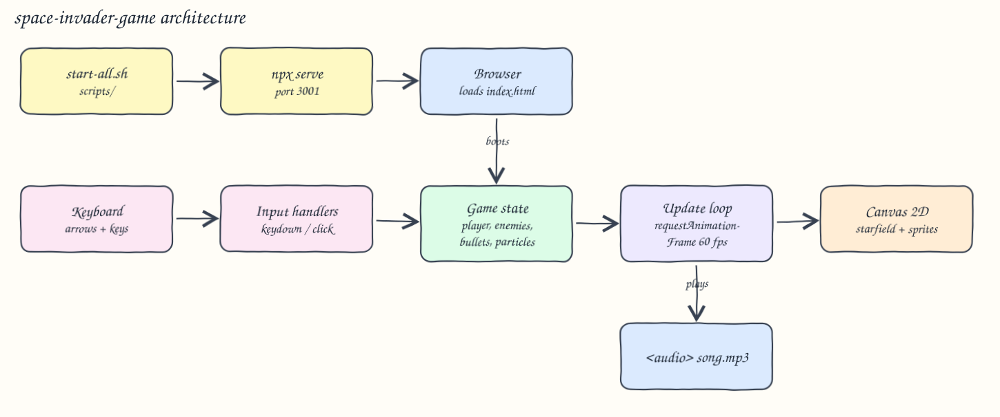
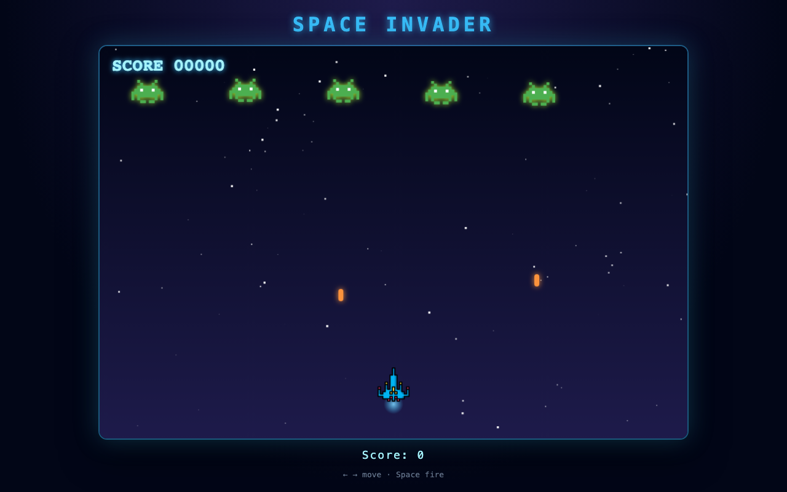
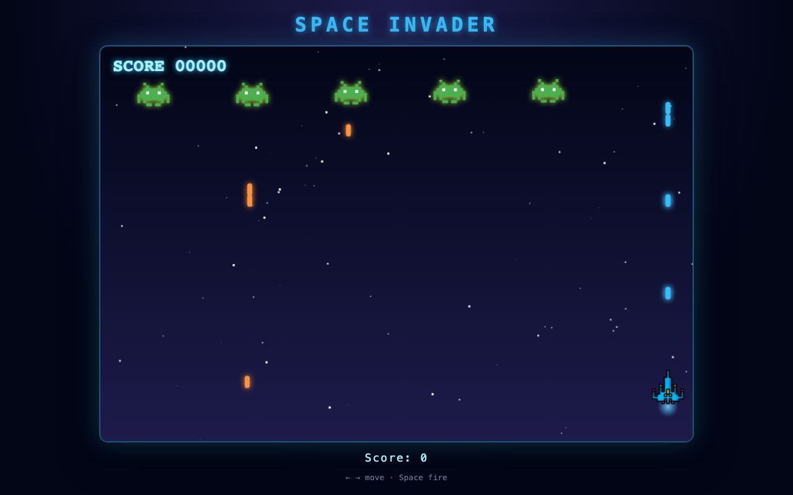

<p align="center"></p>

# Space Invader

A small Space Invaders style shooter in plain JavaScript. Move the ship, shoot the invaders before they reach you and dodge their lasers.

## How it Works

* The browser loads `index.html`, the game lives in one inline script.
* `requestAnimationFrame` runs the loop: move, fire, collide, draw.
* Invaders step sideways once per second and drop down every time one touches an edge.
* Each frame there is a small chance a random invader fires a laser at you.
* A hit invader explodes into particles and gives 100 points.
* A laser on your ship, or an invader reaching your row, ends the game.
* The canvas is drawn at 2x for crisp pixels on high density screens.

## Architecture



## Features

* Starfield background with glow: the arena feels like space without image files.
* Particle bursts: hits and the final explosion give clear feedback.
* Enemy fire: random lasers make standing still dangerous.
* Background song: `song.mp3` loops while you play and stops at game over.

## Stack

* HTML, CSS and plain JavaScript: no build step, no framework, the whole game is one page.
* Canvas 2D: simple sprites, lasers and particles.
* HTML `<audio>`: plays the bundled background song.
* `serve` through `npx`: a static file server for local play, the game itself has no runtime dependencies.
* Bash scripts in `scripts/`: one predictable way to set up, start, check and stop the game.

## Contracts / APIs

There is no backend API. The only contract is the static file server: `GET /` returns `index.html` and every asset is a plain file next to it.

## Key data structures and design decisions

* `player`, `enemies[]`, `bullets[]`, `enemyBullets[]` and `particles[]` are plain objects with x, y, width and height.
* Axis aligned box checks for every hit: cheap and good enough for rectangles.
* Enemies move every 60 frames, not every frame, for the classic step by step march.

## Controls

* Arrow Left and Arrow Right: move.
* Space: fire.
* Reload the page to play again.

## How to run

All scripts live in `scripts/` and run from any directory of the repository.

| Script | What it does |
|---|---|
| `./scripts/setup.sh` | Checks node and npx and fetches the `serve` static server once |
| `./scripts/start-all.sh` | Starts the game server and prints its full link |
| `./scripts/status.sh` | Shows the game server port as UP or DOWN |
| `./scripts/test-all.sh` | Checks the syntax of every script in the game, there are no test suites |
| `./scripts/ui.sh` | Opens the game in the browser |
| `./scripts/stop-all.sh` | Stops the game server |

Ports are declared in `scripts/ports.env`. This game runs on `http://localhost:3001`.

```bash
./scripts/setup.sh
./scripts/start-all.sh
./scripts/status.sh
./scripts/test-all.sh
./scripts/ui.sh
./scripts/stop-all.sh
```

## Printscreens

### Start



The wave of invaders at the top and your ship at the bottom, score at zero.

### Firing



The ship moved right and fires blue lasers up, orange enemy lasers fall toward it.
