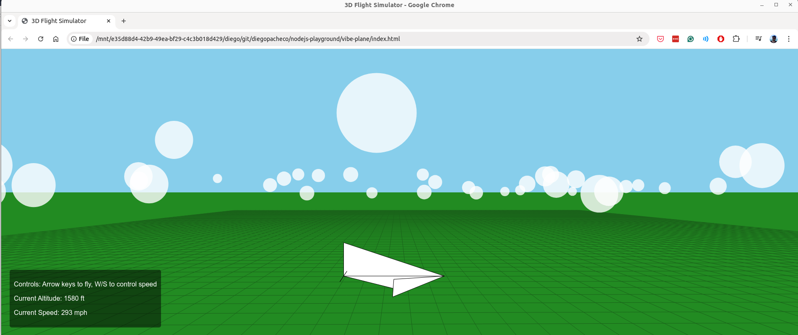

# Vibe Plane



## Description

A third person flight game built with plain HTML and JavaScript, no libraries. The world is drawn with a small canvas 3D renderer: patchwork fields, lakes, trees, a runway, clouds, fog and a flat shaded plane with a spinning propeller.

The world is alive: farms with houses and barns, windmills, grazing sheep and cows, flocks of birds and drifting hot air balloons. The weather cycles between clear, rain with lightning and snow.

## Controls

* Arrow Up and Arrow Down: climb and dive.
* Arrow Left and Arrow Right: bank and turn.
* W and S: throttle up and down.
* 1, 2, 3: clear, rain, snow.
* R: restart.

Fly too slow and the plane stalls. Hit the ground too fast or banked and you crash. A gentle touch down on the ground is a landing.

## How to Run the Game

```bash
npm start
```

Or open `index.html` in a web browser.
