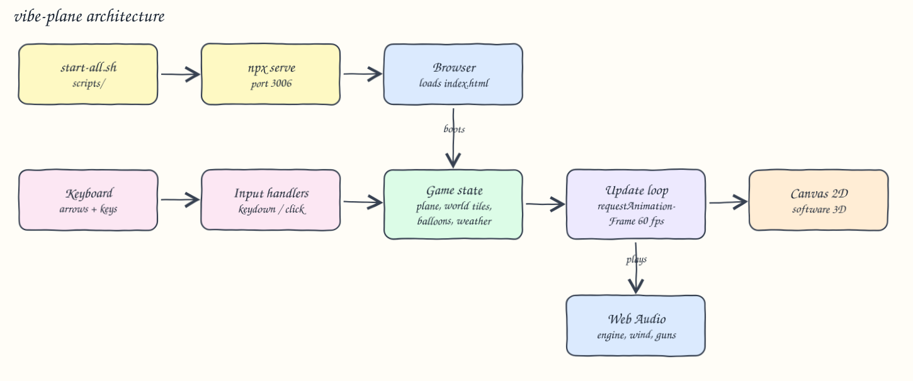
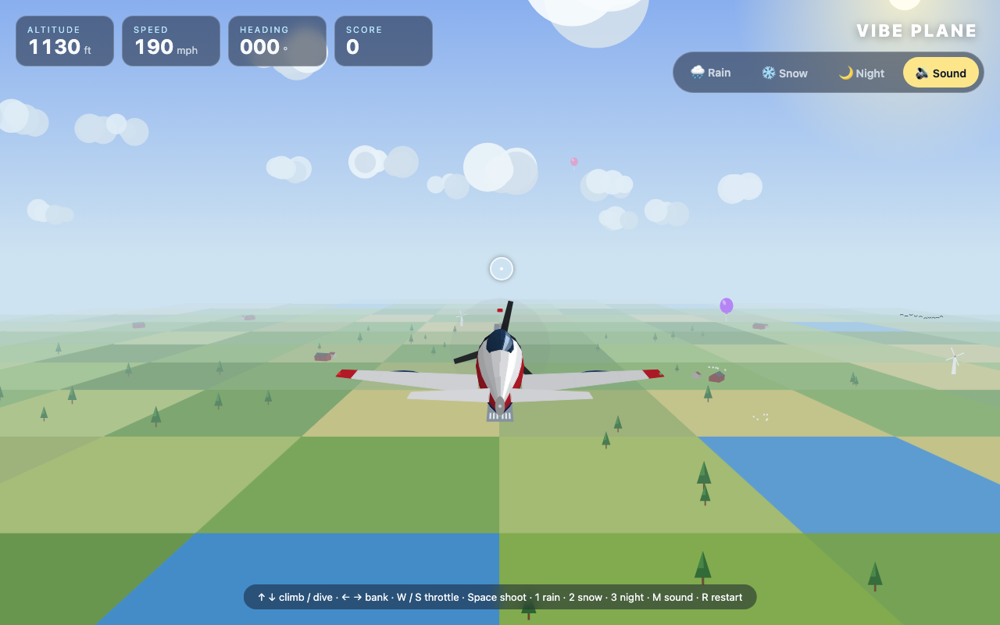
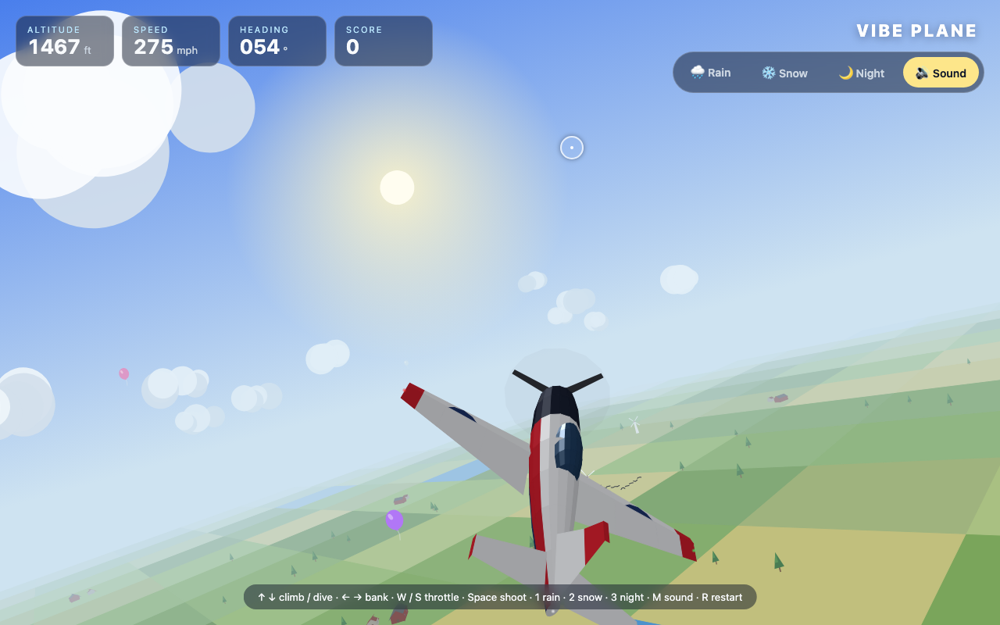

<p align="center"></p>

# Vibe Plane

A third person flight game in plain HTML and JavaScript, no libraries. A small software 3D renderer on a 2D canvas draws a glossy racing plane flying over a living patchwork world with farms, windmills, animals, birds and balloons you can shoot.

## How it Works

* The browser loads `index.html`, which holds all the code.
* Every frame `requestAnimationFrame` advances the flight model: throttle, lift, stall, bank and turn.
* The world is split into tiles of 400 units, only tiles within range are drawn, so the world feels endless.
* Every 3D shape is projected to 2D and painted back to front with fog and a sun or moon light direction.
* Weather (rain, snow, night) swaps the sky, fog and ground palettes and adds particles and lightning.
* Sounds are generated live with the Web Audio API, they start after the first key press or click.

## Architecture



## Features

* Flight model with stall and crash: speed and angle matter, a gentle touch down is a landing.
* Detailed plane: lofted fuselage, tapered wings, canopy, landing gear and a spinning propeller.
* Living world: farms, barns, windmills, sheep, cows and flocks of birds make the scenery feel real.
* Balloons and wing guns: popping a balloon is worth 100 points, a small goal while flying.
* Weather toggles: rain with lightning, snow and night change the mood with one key.
* Generated audio: engine, wind, rain, guns, pops, thunder and warnings without any audio file.

## Stack

* HTML, CSS and plain JavaScript: no build step, no framework, the whole game is one page.
* Canvas 2D with a hand written 3D projection: full control of the look, no WebGL setup.
* Web Audio API: every sound is synthesized, nothing to download.
* `serve` through `npx`: a static file server for local play, the game itself has no runtime dependencies.
* Bash scripts in `scripts/`: one predictable way to set up, start, check and stop the game.

## Contracts / APIs

There is no backend API. The only contract is the static file server: `GET /` returns `index.html` and every asset is a plain file next to it.

## Key data structures and design decisions

* Colors are RGB arrays (`FIELDS`, `FOG`, `NIGHT_SKY`) so the renderer can blend them with fog and light.
* World tiles of `TILE = 400` drawn within `RANGE = 12` tiles: cheap streaming of an endless world.
* One file, one loop: update then render each frame, easy to read and to change.

## Controls

* Arrow Up and Arrow Down: climb and dive.
* Arrow Left and Arrow Right: bank and turn.
* W and S: throttle up and down.
* Space: fire the wing guns.
* 1, 2, 3: toggle rain, snow and night. The buttons at the top right do the same.
* M: toggle sound. R: restart.

## How to run

All scripts live in `scripts/` and run from any directory of the repository.

| Script | What it does |
|---|---|
| `./scripts/setup.sh` | Checks node and npx and fetches the `serve` static server once |
| `./scripts/start-all.sh` | Starts the game server and prints its full link |
| `./scripts/status.sh` | Shows the game server port as UP or DOWN |
| `./scripts/test-all.sh` | Checks the syntax of every script in the game, there are no test suites |
| `./scripts/ui.sh` | Opens the game in the browser |
| `./scripts/stop-all.sh` | Stops the game server |

Ports are declared in `scripts/ports.env`. This game runs on `http://localhost:3006`. You can also open `index.html` straight in a browser.

```bash
./scripts/setup.sh
./scripts/start-all.sh
./scripts/status.sh
./scripts/test-all.sh
./scripts/ui.sh
./scripts/stop-all.sh
```

## Printscreens

### Take off



The plane right after start, flying level over fields, lakes and windmills. The HUD shows altitude, speed, heading and score, the weather buttons are at the top right.

### Banking turn



The plane banking right while climbing at full throttle, the horizon tilts and the guns fire at the balloons ahead.
