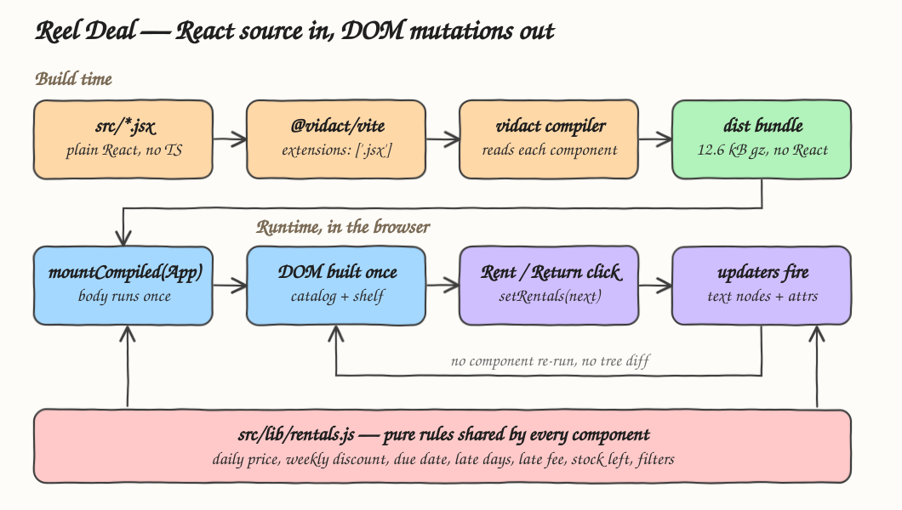
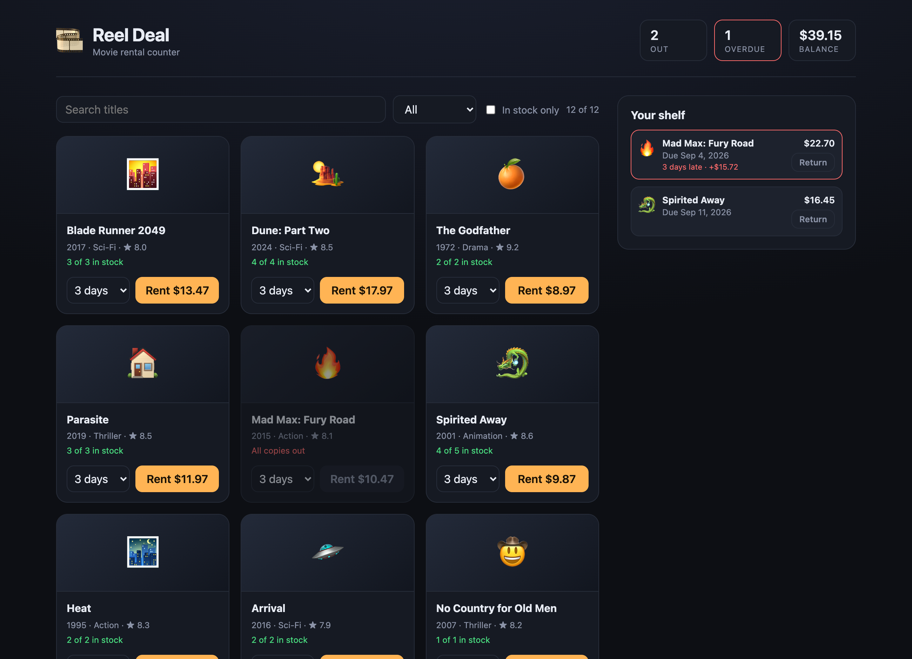
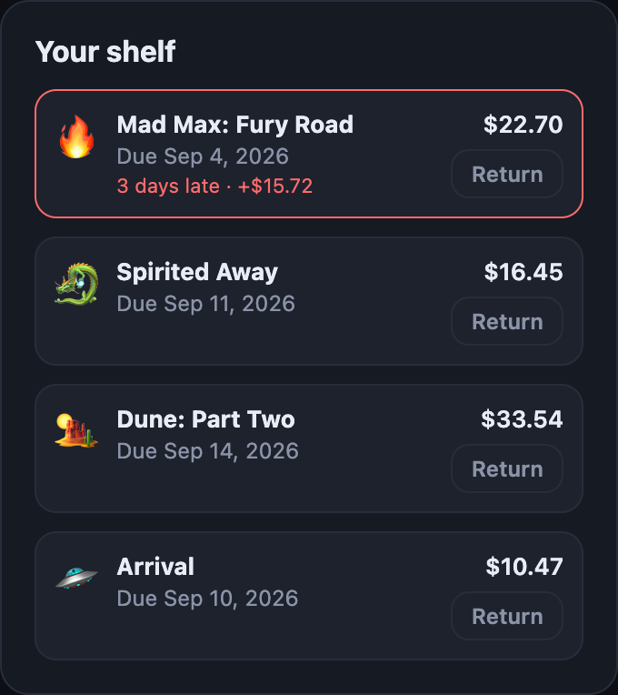
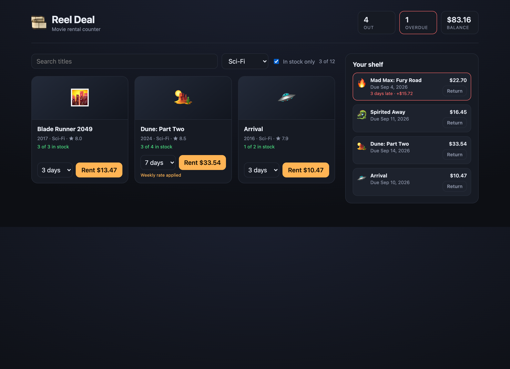

# Reel Deal

A movie rental counter written in plain JavaScript React and compiled to VanillaJS by [Vidact](https://www.vidact.dev/).
Browse a catalogue of 12 titles, pick how many days you want a film for, rent it, watch your shelf and
your balance move, and pay a late fee when you bring it back after the due date.

No React is installed and no React is shipped. The whole app, runtime included, is 12.6 kB gzipped.

## How it Works?

Source files are ordinary React: function components, `useState`, JSX, controlled inputs.
The `@vidact/vite` plugin hands every `.jsx` file to the Vidact compiler at build time, and the compiler
writes the DOM code for each component instead of emitting `createElement` calls.

At runtime the component body runs exactly once, when it mounts. It builds its elements and registers one
updater per reactive expression. Clicking **Rent** calls `setRentals`, and that reaches only the text nodes
and attributes that read `rentals` — the shelf rows, the stock line, the balance, the disabled state of the
button. `App` is never called a second time and no tree is ever diffed.

The rental rules themselves live outside the components, in one pure module every component imports.

## Architecture



## Features

- **Catalogue with live stock** — each card shows copies left, computed from the open rentals rather than stored twice, so stock can never drift out of sync with the shelf.
- **Per-title rental length** — 1, 3, 5, 7 or 14 days chosen on the card itself, because the price depends on it and the customer picks it per film.
- **Weekly rate** — 7 days or more takes 20% off, so a week costs less than six days and long rentals are worth taking.
- **Due dates and late fees** — every rental carries a due date, and a late return adds 1.5x the daily rate per late day, which is what makes returning on time matter.
- **Running balance** — the header totals what is owed right now, late fees included, so the counter clerk never has to add it up.
- **Search, genre and stock filters** — narrow 12 titles down to the ones worth offering, including hiding what is fully rented out.
- **Return** — one click frees the copy back into the catalogue and drops it off the balance.

## Stack

- **Vidact 0.2.0-beta.6** — compiles the React source to DOM code, so the browser ships no framework runtime.
- **Vite 8** — dev server and production build; the Vidact plugin is the only plugin.
- **Node.js 24** — required by Vidact, and its built-in `node:test` runner runs the suite.
- **Plain JavaScript** — no TypeScript, no state library, no CSS framework, no test framework.

## Contracts

There is no backend and no HTTP API. The contract in this app is the pure module every component imports,
`src/lib/rentals.js`:

| Function | Contract |
|---|---|
| `rentalCost(movie, days)` | Cents owed up front. `days >= 7` gets 20% off |
| `dueAt(rentedAt, days)` | Epoch ms the film is due back |
| `lateDays(rental, now)` | Whole days past due, rounded up. 0 when on time |
| `lateFeeCents(movie, rental, now)` | `round(dailyRate * 1.5) * lateDays` |
| `totalDueCents(movie, rental, now)` | `rental.costCents + lateFee` |
| `availableCopies(movie, rentals)` | Copies owned minus copies out |
| `matchesFilters(movie, filters, rentals)` | Whether a title survives the search, genre and stock filters |
| `formatMoney(cents)` / `formatDate(ms)` | Display only |

Money is carried in integer cents everywhere and formatted only at the edge, so no rounding error can reach
a total.

## Key data structures and design decisions

A **movie** is static catalogue data: `{ id, title, year, genre, rating, priceCents, copies, art }`.

A **rental** is the only mutable state: `{ id, movieId, days, rentedAt, dueAt, costCents }`.

`App` holds exactly two pieces of state, `rentals` and `filters`. Everything else is derived on the spot:
availability, the visible catalogue, the overdue count and the balance. Stock is deliberately *not* stored
on the movie, because two sources for the same fact is how a rental counter ends up renting a copy it does
not have.

Four constraints came from the compiler and shaped the code:

- `useState` must bind both the value and the setter, so the read-only "now" is a module constant instead of `const [now] = useState(...)`.
- A `key` in a mapped list must be `key={item}` or `key={item.property}`, so each shelf row is its own `RentalRow` component mapped directly, rather than a `map` with a block body.
- Custom hooks must live in the module that calls them, so shared logic is plain functions in `src/lib/rentals.js` instead of hooks.

The first three stop the build at the offending line and name the API. The fourth does not, and it is the one
that actually bit: derived state has to be an *expression* the compiler can track. Filling an object with a
`for` loop in the component body compiles fine and then runs once, at mount, so the stock line on every card
froze at its opening value while the shelf and the balance updated correctly. Stock is now computed inside
the mapped JSX, `available={availableCopies(movie, rentals)}`, which the compiler wires to `rentals`.

## How to run

```bash
./scripts/setup.sh
./scripts/start-all.sh
./scripts/ui.sh
./scripts/stop-all.sh
```

The app runs at http://localhost:5173

Tests and the production build:

```bash
./scripts/test-all.sh
```

## Printscreens

### Catalogue

The counter on open. Two rentals are already out: *Mad Max: Fury Road* is three days late, so its shelf row
is outlined in red and carries a $15.72 late fee, and the header shows 1 overdue against a $39.15 balance.
*Mad Max* has a single copy and it is out, so its card reads "All copies out" and its Rent button is
disabled. Every other card shows copies left, the chosen rental length and the price for that length.



### Shelf

The shelf after renting *Dune: Part Two* for 7 days and *Arrival* for 3. Dune's $41.93 at the daily rate
became $33.54 under the weekly rate. The overdue row stays pinned in red with its running late fee, and each
row shows the amount owed for that film alone.



### Filters

Genre set to Sci-Fi with "In stock only" checked. Twelve titles narrow to the three sci-fi films that still
have a copy on the shelf, the counter reads "3 of 12", and the balance and shelf on the right are untouched
by filtering.



## Scripts

All scripts live in `scripts/` and run from any directory of the repository.

| Script | What it does |
|---|---|
| `./scripts/setup.sh` | Installs dependencies and builds the app |
| `./scripts/start-all.sh` | Starts the dev server and waits for its port |
| `./scripts/status.sh` | Shows the service port as UP or DOWN |
| `./scripts/test-all.sh` | Runs the unit tests and the production build |
| `./scripts/ui.sh` | Opens the UI in the browser |
| `./scripts/stop-all.sh` | Stops the dev server |

Ports are declared in `scripts/ports.env`.

```bash
./scripts/setup.sh
./scripts/start-all.sh
./scripts/status.sh
./scripts/ui.sh
./scripts/stop-all.sh
```
