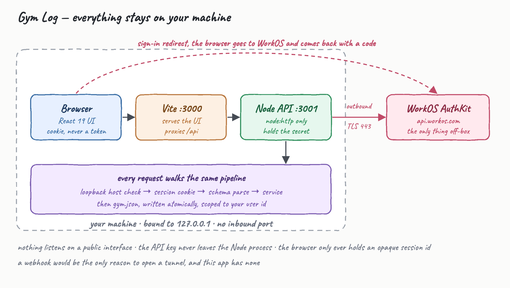
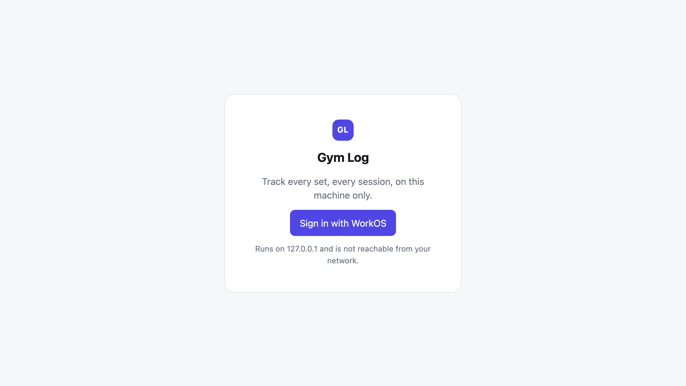
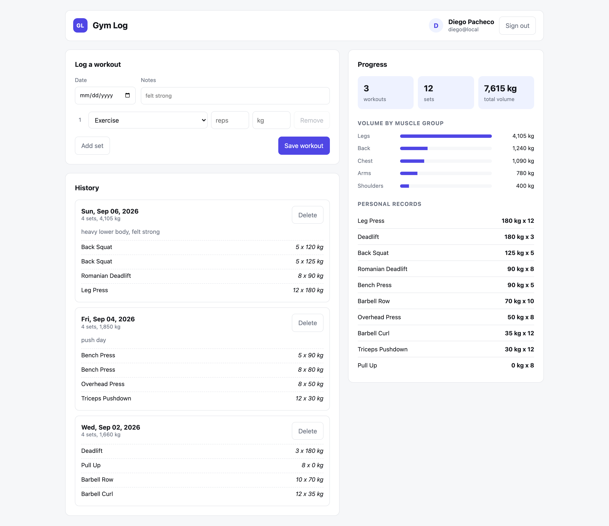
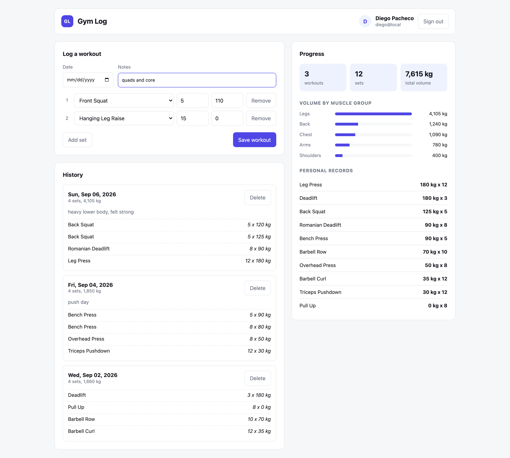
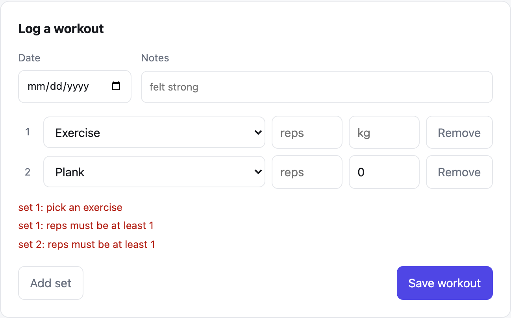

A gym tracker that runs entirely on your machine. You sign in with your real WorkOS AuthKit account, log workouts set by set, and see volume and personal records build up over time. Nothing listens on a public interface, no tunnel is opened, and your WorkOS API key never leaves the Node process.

## How it Works

Vite serves the React UI on `127.0.0.1:3000` and proxies `/api` to a Node HTTP server on `127.0.0.1:3001`. Both bind the loopback interface only, and the API additionally rejects any request whose `Host` header is not loopback.

Signing in sends your browser to WorkOS AuthKit with a one-time `state` value. WorkOS sends the browser back to `/api/auth/callback` with a code. The Node process, and only the Node process, exchanges that code for a profile using the API key. It then mints an opaque 32-byte session id, keeps the profile in memory, and hands the browser an `HttpOnly` `SameSite=Lax` cookie. The browser never sees a token, a key, or a JWT.

Every request after that walks the same pipeline: loopback host check, session cookie lookup, schema parse of the body, then the service. Workouts land in `backend/data/gym.json`, written atomically and always filtered by the session's user id.

The only traffic that leaves the machine is the outbound TLS call to `api.workos.com`.

## Architecture



## Features

- **WorkOS AuthKit sign-in** — real hosted authentication without shipping a password form or storing a credential.
- **Loopback lockdown** — server binds `127.0.0.1` and rejects non-loopback `Host` headers, so a stray `--host` flag cannot expose it.
- **Server-held secret** — the API key is used only for the token exchange inside Node, so the browser bundle has nothing worth stealing.
- **Opaque session cookie** — the cookie is a random id with no meaning outside the server's memory, so forging one is not possible and logging out kills it instantly.
- **Runtime-validated types** — every request body is parsed by a schema before any service sees it, so malformed data cannot reach the store.
- **Per-user data isolation** — reads and deletes are filtered by user id in the store itself, not in a caller that might forget.
- **Set-by-set logging** — a workout is a list of sets, each with an exercise, reps and weight, which is what makes volume meaningful.
- **Volume and personal records** — volume per muscle group shows training balance, and records track the heaviest set ever hit per exercise.

## Stack

- **Node 20+ (`node:http`)** — the standard library covers routing, cookies and JSON, so the backend has zero runtime dependencies.
- **`fetch` against the WorkOS REST API** — two endpoints are all AuthKit needs, so the SDK would add weight without adding capability.
- **React 19** — component state is the whole UI model here; no router or state library was needed.
- **Vite 7** — dev server, JSX transform and the `/api` proxy that makes the app single-origin.
- **`node:test`** — the built-in runner, so tests need no dependency either.
- **JSON file storage** — a single-user local tracker does not justify a database process.

## API

All routes are served from the Node process and reachable only over loopback. Everything under `/api/exercises`, `/api/workouts` and `/api/stats` requires the session cookie and answers `401` without it.

| Method | Path | Body | Answers |
|---|---|---|---|
| `GET` | `/api/health` | — | `{ status }`, the only unauthenticated route |
| `GET` | `/api/auth/login` | — | `302` to WorkOS AuthKit with a one-time `state` |
| `GET` | `/api/auth/callback` | — | `302` back to the UI, sets the session cookie |
| `GET` | `/api/auth/me` | — | `{ user }` or `{ user: null }` |
| `POST` | `/api/auth/logout` | — | `{ logoutUrl }`, clears the cookie |
| `GET` | `/api/exercises` | — | `{ exercises }`, the catalog |
| `GET` | `/api/workouts` | — | `{ workouts }`, newest first |
| `POST` | `/api/workouts` | `{ date?, notes?, sets[] }` | `201 { workout }` |
| `DELETE` | `/api/workouts/:id` | — | `{ deleted }` or `404` |
| `GET` | `/api/stats` | — | `{ stats }` |

Logging a workout:

```bash
curl -X POST http://localhost:3000/api/workouts \
  -H 'content-type: application/json' \
  -b "gym_session=$YOUR_COOKIE" \
  -d '{"notes":"push day","sets":[{"exerciseId":"bench-press","reps":5,"weightKg":90}]}'
```

A rejected body answers `422` and names every field that failed at once:

```json
{
  "error": "Workout is invalid",
  "issues": [
    { "path": "Workout.sets[0].reps", "message": "must be at least 1" },
    { "path": "Workout.sets[0].weightKg", "message": "must be at least 0" }
  ]
}
```

## Key Data Structures and Design Decisions

**Types are runtime schemas, not comments.** `backend/src/types/schema.js` is a small combinator library: `defineType` composes field validators like `str`, `int`, `num`, `enumOf`, `list` and `optional` into a type with a `parse` that throws or returns a clean object. A JSDoc type would describe the shape; this one enforces it at the HTTP boundary, which is the only place untrusted data enters.

```js
export const SetEntry = defineType('SetEntry', {
  exerciseId: str({ max: 60 }),
  reps: int({ min: 1, max: 500 }),
  weightKg: num({ min: 0, max: 1000 })
})
```

**A validator returns `{ value }` or `{ issues }` rather than throwing.** That is what lets a nested `list` collect every failure across every set and report them together, instead of stopping at the first one.

**Sessions are a `Map` of opaque id to profile.** The alternative, a signed JWT in the cookie, would mean verifying WorkOS JWKS on every request for a single-user local app. Server-side sessions make logout instant and keep zero cryptographic material in the browser. They reset when the API restarts, which for a local tracker means signing in again.

**The store filters by user id, not the caller.** `readWorkouts(userId)` and `removeWorkout(userId, id)` take ownership as an argument, so a route that forgot to check cannot read another account's data. `present()` then strips `userId` before anything is serialized back.

**Writes are atomic and serialized.** The store writes a temp file and renames it, and chains writes on a promise, so a crash mid-write cannot leave a truncated `gym.json`.

**Ports come from `scripts/ports.env`.** The scripts, the Vite proxy and the Node server all read the same source, so a port change is one edit.

## How to Run

Node 20 or newer is required.

```bash
./scripts/setup.sh
```

That installs dependencies and creates `.env` from `env.template`, then prints the WorkOS steps below.

### Configure WorkOS

In the dashboard, once per environment:

1. Sign in at **https://dashboard.workos.com**.
2. Top left, pick the environment you want. Staging issues keys starting with `sk_test_`, Production `sk_live_`.
3. Open **https://dashboard.workos.com/environment/applications** and click your application.
4. Open that application's **Redirects** tab and set both values exactly, with no trailing slash:

   | Field | Value |
   |---|---|
   | Redirect URI | `http://localhost:3000/api/auth/callback` |
   | Sign-out URI | `http://localhost:3000` |

   The Redirect URI is where WorkOS sends the browser back with the authorization code. The Sign-out URI is where it returns after logout — **logout fails without it**, because the app passes `return_to` and WorkOS only honours a registered value.
5. Copy the **Client ID** from that same application page. It starts with `client_`.
6. Open **API Keys** in the left sidebar and copy the secret key. It starts with `sk_`.

Then store both values:

```bash
./scripts/configure-workos.sh
```

It asks for one value at a time, checks each against the WorkOS API before accepting it, and writes `.env` with `600` permissions. The API key is typed hidden and is never echoed, logged, or passed on a command line — the terminal only ever shows its public prefix and length. Run `./scripts/configure-workos.sh --steps` to reprint the instructions, or `--offline` to skip the live checks.

```bash
./scripts/start-all.sh
./scripts/ui.sh
```

`start-all.sh` refuses to start while `.env` still holds placeholders, so a misconfigured run fails immediately instead of at the first sign-in.

### Where the password lives

**WorkOS stores and manages every password on their side. This app never sees one.**

There is no user table, no password column, no hashing code, and no login form in this repository. Grep it and you will find zero credential handling. The sign-in form you type into is served by WorkOS at `*.authkit.app`, not by this app. The password goes from your browser straight to WorkOS and never touches the Node process or `gym.json`.

What this app gets back, after WorkOS has already checked the password, is a one-time authorization code. It trades that code for a profile — id, email, name — and stores only that in memory. So the strongest thing an attacker could take from this machine is a workout log.

That also means password rules are WorkOS's to set, not this app's. Their policy currently requires **10 or more characters** and rejects **commonly used passwords**, which is why `admin` cannot be used as one.

### Default account

Create it with:

```bash
./scripts/create-user.sh
```

| Field | Value |
|---|---|
| Email | `admin@gymlog.local` |
| Password | `GymLogAdmin2026` |

The script calls the WorkOS API with your key and creates the account in your environment, pre-verified so no inbox is needed. Running it twice is safe — an existing user is reported and left alone. Pass your own values to override: `./scripts/create-user.sh you@example.com 'your-password'`.

This account lives in your WorkOS environment, not in this repo, and you can delete it from **Users** in the dashboard at any time. Since it is written above in plain text, treat it as a local convenience only — change it before pointing this app at a Production environment.

To create an account by hand instead, click **Sign in with WorkOS** and choose **Sign up** on the hosted page.

Workouts are keyed by the WorkOS user id, so signing in with a second account gives you a separate, empty log rather than a shared one.

### If sign-in fails with "WorkOS rejected the sign in"

Run the doctor:

```bash
./scripts/doctor.sh
```

It checks the Client ID alone, the API key alone, and then the two together, and prints a verdict. The third check is the one that matters: each credential can be perfectly valid on its own while the pair is still refused.

```
checks
  client id alone       ok, AuthKit domain stable-hill-69-staging.authkit.app
  api key alone         ok, 2 users in its environment
  the two together      FAILED, invalid_client
                        You may be using a client secret from a different application.
```

That means the Client ID and API key come from **different applications or different environments**. Open the dashboard, use the top-left picker to select the environment whose AuthKit domain matches the one the doctor printed, and take *both* values from it — Client ID from **Applications → your app**, key from **API Keys** in the sidebar. Every non-production environment issues `sk_test_` keys, so that prefix does not prove the key came from the right one.

The API reads `.env` once at boot, so **restart after changing it** — `./scripts/stop-all.sh && ./scripts/start-all.sh`.

### Tests

```bash
./scripts/test-all.sh
```

Runs the backend suite and the frontend production build. The suite covers schema rejection, router matching, volume and personal-record math, per-user isolation in the store, and that a forged or logged-out session id is refused.

```
ℹ tests 31
ℹ pass 31
ℹ fail 0
```

## Staying Off the Network

- Both servers bind `127.0.0.1`, never `0.0.0.0`.
- The API rejects any request whose `Host` header is not loopback with `403`.
- `.env` is git-ignored and created with `600` permissions; only `env.template` with placeholders is committed.
- `backend/data/` is git-ignored, so your workout log is never committed.
- The API key is read in Node and used only for the token exchange; it is never sent to the browser and never appears in a URL.
- The session cookie is `HttpOnly` and `SameSite=Lax`. It is not `Secure`, because the local app is served over plain HTTP on loopback. Adding TLS is the one change needed before this could be exposed anywhere.
- Nothing needs an inbound connection. A WorkOS webhook would be the only reason to open a tunnel, and this app subscribes to none.

## Printscreens

### Sign in



The only screen available without a session. The button navigates to `/api/auth/login`, which redirects to WorkOS AuthKit with a one-time `state`. If a sign-in is cancelled or the `state` does not come back intact, the app returns here with the reason instead of a stack trace.

### Dashboard



The signed-in view. The header shows the profile WorkOS returned and a sign-out that destroys the server session and clears the cookie. On the left, the log form and the full history, each workout showing its set count, total volume, notes and every set. On the right, the progress panel: three tiles for workouts, sets and lifetime volume, then volume per muscle group as bars, then the heaviest set recorded for each exercise.

### Logging a workout



A workout in progress. Sets are added one at a time, each picking an exercise from the catalog with reps and weight. The date defaults to now when left blank. On save the payload is posted to `/api/workouts`, parsed against the `Workout` schema on the server, and the history and stats both refresh.

### Validation



The form checks the draft before sending and lists every problem at once rather than stopping at the first. The same rules are enforced again on the server, so a request that skips the UI is rejected the same way, with a `422` naming each field.

## Scripts

All scripts live in `scripts/` and run from any directory of the repository.

| Script | What it does |
|---|---|
| `./scripts/setup.sh` | Installs dependencies and prepares the app |
| `./scripts/configure-workos.sh` | Asks for the client id and api key, validates both against WorkOS, writes `.env` |
| `./scripts/create-user.sh` | Creates the default `admin@gymlog.local` account in your WorkOS environment |
| `./scripts/doctor.sh` | Checks the WorkOS credentials alone and as a pair, and explains any failure |
| `./scripts/start-all.sh` | Starts every service and waits for its port |
| `./scripts/status.sh` | Shows every service port as UP or DOWN |
| `./scripts/test-all.sh` | Runs every test suite |
| `./scripts/ui.sh` | Opens the UI in the browser |
| `./scripts/stop-all.sh` | Stops every service |

Ports are declared in `scripts/ports.env`.

```bash
./scripts/setup.sh
./scripts/configure-workos.sh
./scripts/start-all.sh
./scripts/status.sh
./scripts/ui.sh
./scripts/stop-all.sh
```
